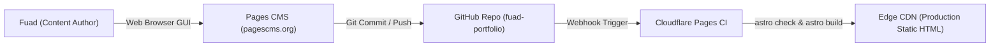
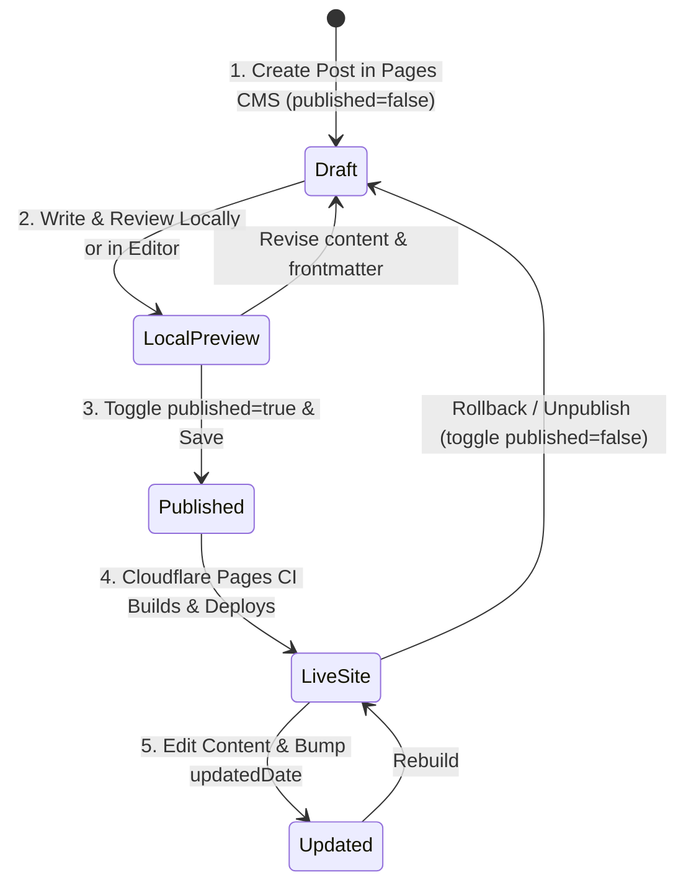

# Editorial Workflow & Content Strategy Guide

This guide establishes the editorial workflow, content formatting standards, frontmatter specifications, and publishing procedures for **Fuad Hasan's Professional Portfolio and Technical Blog**.

---

## 1. System Architecture & Content Pipeline

The portfolio operates on a **zero-runtime, static-first GitOps content pipeline**:



### Key Architectural Guarantees
1. **Zero Manual Code Changes:** Authors never touch TypeScript, Astro components, layouts, or CSS to publish, update, or unpublish content.
2. **Strict Type Safety:** Astro Content Collections enforce strict Zod schema validation during every build. Any malformed frontmatter halts the build before bad data reaches production.
3. **Draft Isolation:** Unpublished drafts (`published: false`) are completely omitted from public routes, client search indexes, RSS feeds, and XML sitemaps.
4. **Zero Paid Services:** The entire pipeline leverages free-tier GitHub, Pages CMS, and Cloudflare Pages infrastructure with zero recurring operational cost.

---

## 2. Accessing and Navigating Pages CMS

1. **Dashboard URL:** Open **[https://pagescms.org](https://pagescms.org)** in any modern desktop or tablet browser.
2. **Authentication:** Click **"Log in with GitHub"** and authenticate with your GitHub credentials (`fuadhasan01`).
3. **Repository Selection:** Select `fuadhasan01/fuad-portfolio` on the `main` branch.
4. **Configured Collections:** Pages CMS parses [`.pages.yml`](file:///d:/Playground/fuad-portfolio/.pages.yml) and displays two collections:
   - **Technical Blog Posts** (`src/content/blog/`)
   - **Project Case Studies** (`src/content/projects/`)

---

## 3. Article Frontmatter Specification

Every Markdown post in `src/content/blog/` begins with a YAML frontmatter block. The table below outlines all supported fields, constraints, and validation rules:

| Field Name | Type | Required | Default | Validation & Editorial Guidelines |
|---|---|---|---|---|
| `title` | `string` | **Yes** | — | Minimum 5 characters. Must be descriptive, specific, and professional. E.g., *"Understanding the Outbox Pattern in .NET Applications"*. |
| `excerpt` | `text` | **Yes** | — | Minimum 10 characters. Aim for 120–160 characters. Displayed on the blog index cards and used as fallback meta description. |
| `published` | `boolean` | **Yes** | `false` | When `false`, the article is a private draft. When `true`, it is publicly built into routes, search, RSS, and sitemap. |
| `pubDate` | `date` | **Yes** | — | Format: `YYYY-MM-DD`. Original publication date. |
| `updatedDate` | `date` | No | — | Format: `YYYY-MM-DD`. Must be $\ge$ `pubDate`. Populate only when substantive revisions or code updates are made. |
| `category` | `select` | **Yes** | — | Must be one of 6 approved topics: `ASP.NET Core`, `Architecture`, `Distributed Systems`, `Databases`, `Angular`, `Engineering Notes`. |
| `tags` | `list` | **Yes** | — | Array of strings (min 1). E.g., `["ASP.NET Core", "EF Core", "SQL Server"]`. Capitalize properly. |
| `cover` | `image` | **Yes** | — | Path must begin with `/images/blog/`. Recommended resolution: 800×450px or 16:9 ratio (SVG or WebP/PNG). |
| `coverAlt` | `string` | **Yes** | — | Minimum 5 characters. Mandatory for WCAG 2.2 AA accessibility. Clearly describe the architectural diagram or graphic. |
| `seoTitle` | `string` | No | — | Maximum 70 characters. Overrides standard `<title>` tag. If omitted, defaults to `[title] | Fuad Hasan`. |
| `seoDescription` | `text` | No | — | Maximum 160 characters. Overrides standard meta description. If omitted, defaults to `excerpt`. |

### Example Valid Frontmatter Block

```yaml
---
title: "Understanding the Outbox Pattern in .NET Applications"
excerpt: "How to improve reliability between database updates and asynchronous event delivery in distributed systems."
published: true
pubDate: 2026-11-13
updatedDate: 2026-11-13
category: "Distributed Systems"
tags: ["ASP.NET Core", "MassTransit", "Architecture", "PostgreSQL"]
cover: "/images/blog/outbox-pattern.svg"
coverAlt: "Outbox processing flow diagram showing transactional boundaries"
seoTitle: "Outbox Pattern in .NET Applications | Fuad Hasan"
seoDescription: "A practical guide to implementing the transactional outbox pattern with ASP.NET Core and MassTransit."
---
```

---

## 4. Markdown Formatting & Typography Guidelines

To maintain visual consistency and preserve the reading experience, adhere to these guidelines:

### A. Heading Hierarchy
- **Never use `# H1` inside the Markdown body.** The article title is automatically rendered as the page H1.
- Begin major sections with `## H2`.
- Use `### H3` for subsections.
- Use `#### H4` for specific code breakdowns or deep subsections.
- **Never skip heading levels** (e.g., jumping from `## H2` directly to `#### H4` violates accessibility standards and breaks the Table of Contents).

### B. Code Blocks & Syntax Highlighting
- Always specify the language identifier on fenced code blocks:
  - ````csharp ... ```` for C# / ASP.NET Core
  - ````typescript ... ```` for TypeScript / Angular
  - ````sql ... ```` for SQL Server / PostgreSQL queries
  - ````bash ... ```` for CLI / shell commands
  - ````json ... ```` for configuration / payloads
- The custom reader layout automatically provides:
  - Top header toolbar with language label
  - Copy-to-clipboard button with visual feedback
  - Horizontal scrolling for long lines without layout blowout
- Avoid pseudo-code or unformatted indentation; provide authentic, clean, production-grade snippets.

### C. Architectural Callout Blocks
Highlight important warnings, best practices, or architectural notes using standard alert blocks:

```markdown
> [!NOTE]
> Background details or context explaining the rationale behind this pattern.

> [!TIP]
> Performance recommendation, indexing advice, or query optimization hint.

> [!IMPORTANT]
> Critical step or requirement that must not be skipped.

> [!WARNING]
> Common pitfalls, concurrency edge cases, or potential memory leaks.
```

### D. Tables
Format Markdown tables cleanly with header rows and separator dashes:

```markdown
| Strategy | Pros | Cons | Recommended Use Case |
|---|---|---|---|
| Single Transaction | Atomic, zero dual-write | DB write load | Core financial transactions |
| Outbox Relay | High throughput, decoupled | Eventual consistency | Microservices & async tasks |
```

### E. Diagrams and Visual Media
- Save all blog diagram assets in [`public/images/blog/`](file:///d:/Playground/fuad-portfolio/public/images/blog/).
- Prefer clean, dark-themed SVG diagrams with inline dimensions (`viewBox="0 0 800 450"`).
- Always ensure valid XML syntax (closing quotes on all attributes).
- For screenshots, compress to WebP or optimized PNG.

---

## 5. Editorial Lifecycle: From Idea to Production



### Step 1: Create a Draft Post
1. In Pages CMS, click **"Technical Blog Posts"** $\rightarrow$ **"New entry"**.
2. Fill in the Title, Excerpt, Publication Date, Category, and Tags.
3. Keep the **"Published"** toggle **OFF** (`published: false`).
4. Write your article outline or rough draft.
5. Click **"Save"**. Pages CMS commits the new `.md` file to GitHub.
6. The draft is safe: the automated build will not publish it to the live site.

### Step 2: Content Review & Quality Polish
- Verify code blocks compile mentally and adhere to clean architecture.
- Confirm headings form an intuitive Table of Contents.
- Ensure all diagrams have appropriate contrast in dark and light modes.
- Verify that every technical claim reflects accurate engineering principles.

### Step 3: Publish to Production
1. In Pages CMS, toggle **"Published"** to **ON** (`published: true`).
2. Click **"Save"**.
3. Pages CMS pushes the commit to GitHub `main`.
4. Cloudflare Pages detects the commit, runs `astro check && astro build`, and deploys the new static site within 60–90 seconds.

### Step 4: Post-Publish Verification (5-Minute Audit)
- Open `https://fuadhasan.is-a.dev/blog/[your-slug]/` in your browser.
- Verify the article title, reading time, tags, and cover image render cleanly.
- Test the Table of Contents jump links.
- Test the code block copy button.
- Check that the post appears on the `/blog` index and within client-side search.
