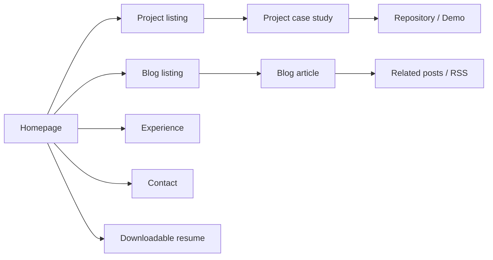
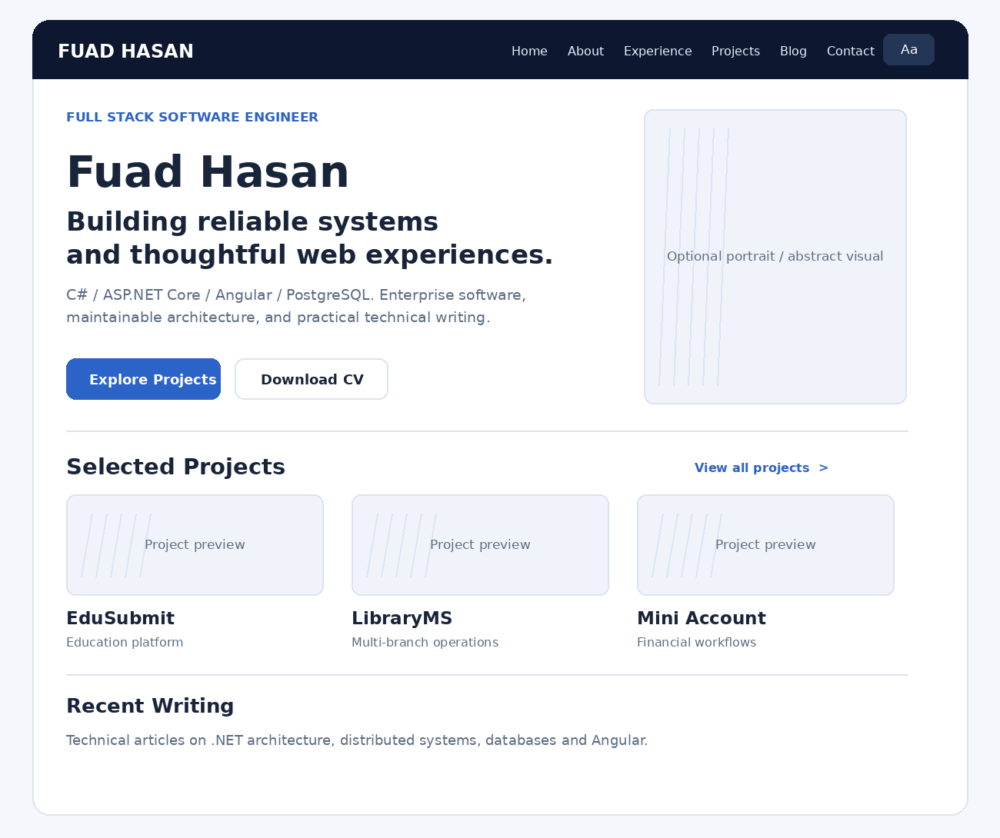
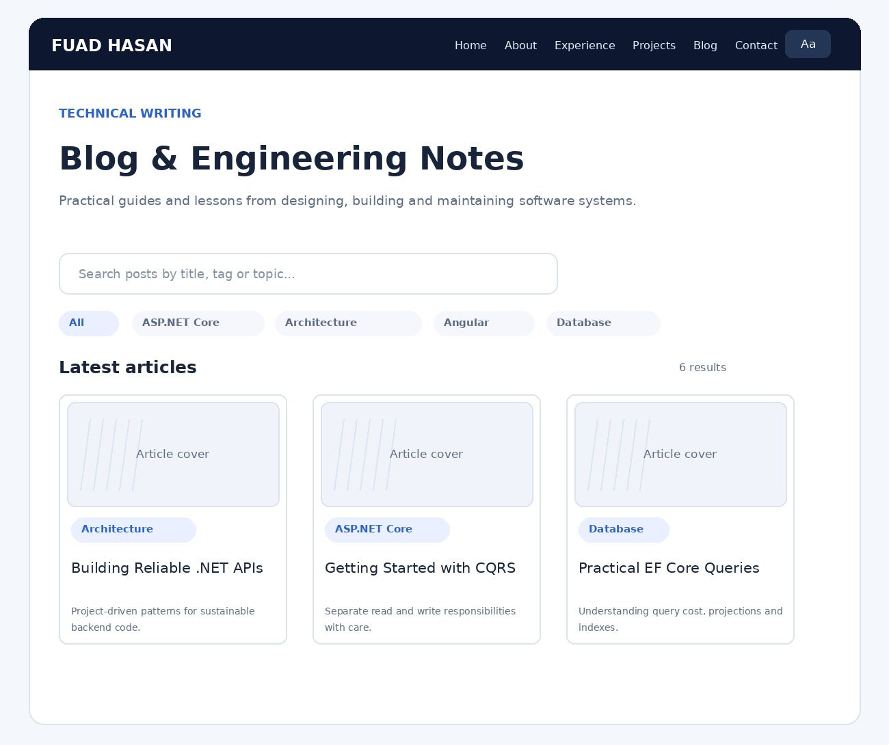
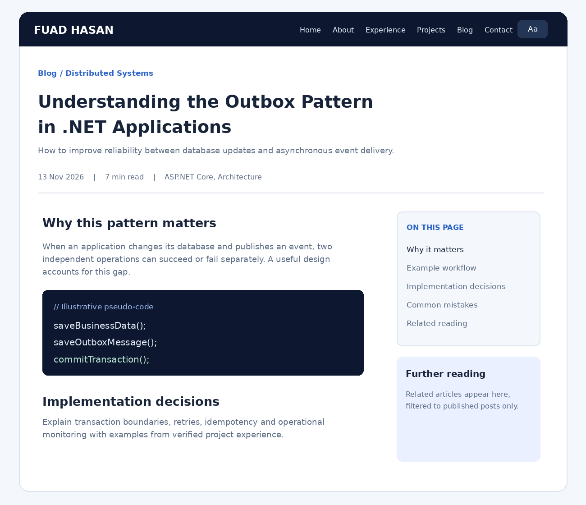
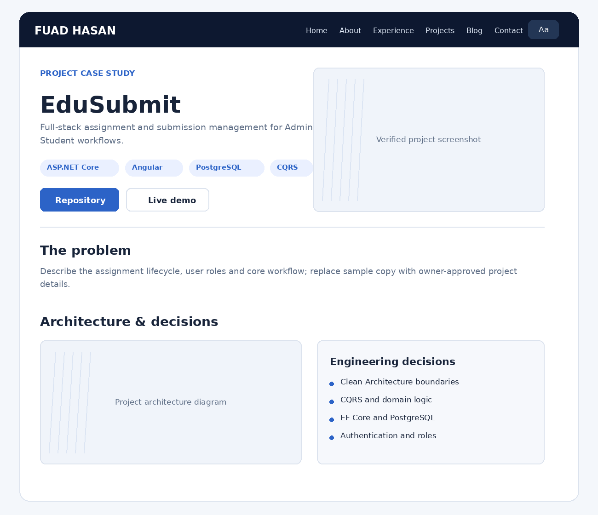
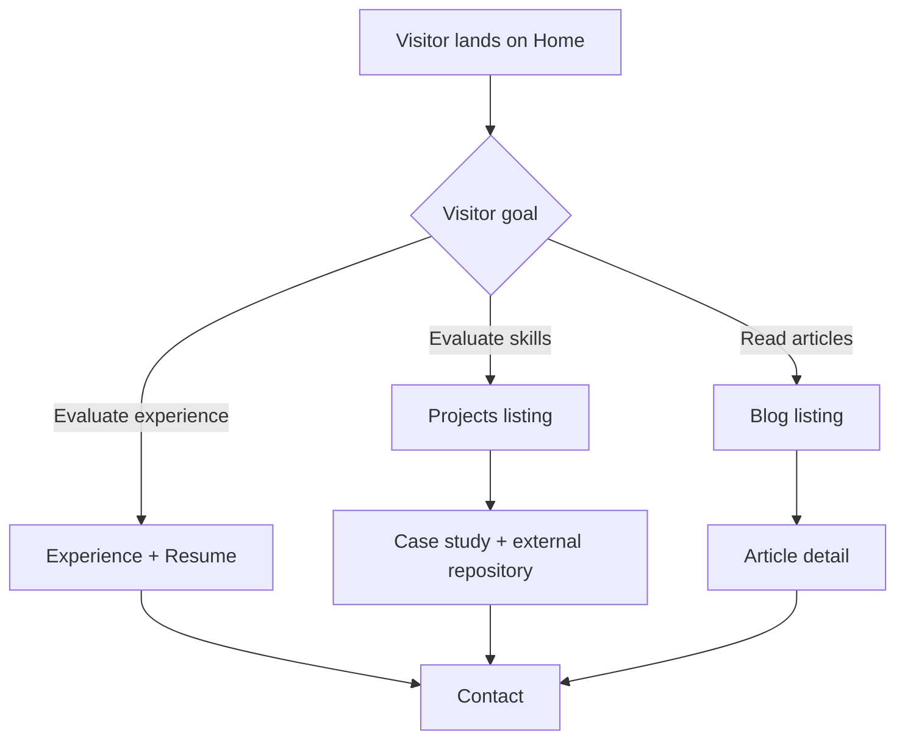
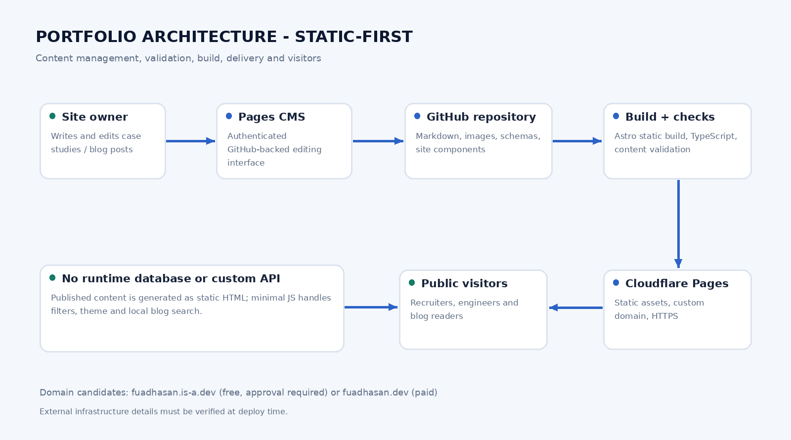
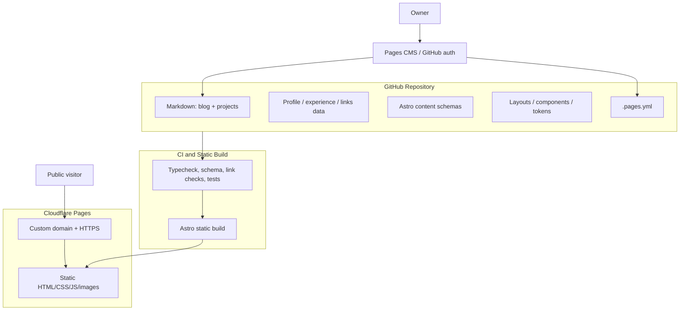

# Software Requirements Specification (SRS)
## Fuad Hasan | Professional Portfolio & Technical Blog

**Document ID:** FH-PORTFOLIO-SRS-001  
**Version:** 1.0 (proposed implementation baseline)  
**Prepared:** 13 November 2026  
**Project owner:** Fuad Hasan  
**Status:** Ready for design and implementation review  
**Primary audience:** AI coding agent, developer, reviewer, designer, and site owner  
**Source of truth:** Resume supplied by the owner, prior agreed portfolio direction, and official framework/provider documentation (references at end).

> **Document rule:** The resume is the source for professional facts. Technology and design choices below are *proposals*, not claims about completed implementation. The agent must not invent achievements, work results, testimonials, endorsements, or project functionality. If source materials are missing, create a clearly marked `TODO` and proceed with a safe default.

---

# 1. Executive Summary

## 1.1 Product vision

Build a polished, real-world personal website for **Fuad Hasan**, a Full Stack Software Engineer focused on C#, ASP.NET Core, Angular, database systems, and scalable application architecture. The website must help recruiters, engineering managers, and developers quickly evaluate his experience, inspect evidence of project work, and read practical technical articles.

The website is a **long-term professional asset**, not a demonstration assignment. It must be easy to update, inexpensive to operate, accessible, fast, search-engine discoverable, and free from inaccurate professional claims.

## 1.2 Objectives and outcomes

| ID | Business objective | Practical success indicator |
|---|---|---|
| OBJ-01 | Present an authentic professional identity | Role, core skills, experience and featured projects discoverable from the home page |
| OBJ-02 | Convert interest into meaningful professional contact | Email and professional profile links work across desktop and mobile |
| OBJ-03 | Provide evidence of engineering capability | Every featured project links to a case study with responsibilities, architecture and verified outcomes |
| OBJ-04 | Publish technical writing independently | Owner can publish or update a post through CMS without changing source code manually |
| OBJ-05 | Keep ongoing operational cost minimal | Static hosting and CMS require no paid backend; only optional domain renewal |
| OBJ-06 | Maintain professional quality | Testable accessibility, SEO, performance, security and deployment criteria |

**Success indicators are targets, not measured results.** Analytics can later show visitors, project clicks, blog reads and outbound-contact interactions where privacy expectations permit.

## 1.3 Proposed baseline technology

| Concern | Selection | Rationale |
|---|---|---|
| Site generator | Astro, TypeScript (strict) | Content-focused static generation and typed data |
| Styling | Tailwind CSS | Consistent design tokens and responsive utilities |
| Components | Astro components; client JS only when needed | Avoid unnecessary frontend hydration |
| Structured content | Astro content collections + Zod schemas | Strong validation for posts and project case studies |
| Authoring | Markdown | Portable, version-controlled writing |
| Editorial UI | Pages CMS, GitHub-backed | No custom admin backend or database |
| Static hosting | Cloudflare Pages | Git-based automated deployment and custom domain support |
| Code + content repository | GitHub | Auditable source of truth and content history |
| Analytics | Cloudflare Web Analytics | Minimal operating overhead |
| Deployment domain | `fuadhasan.is-a.dev` candidate | Free developer subdomain, subject to approval/availability |
| Independent domain alternative | `fuadhasan.dev` candidate | Paid domain with independent ownership, subject to availability |

**Boundary:** Do not introduce ASP.NET Core, PostgreSQL, authentication, server-side rendering, or a paid CMS into v1 without an approved requirement. Fuad's case studies demonstrate his backend experience; the portfolio itself is best served statically.

## 1.4 Scope summary

**Included in launch:** responsive site, dark/light theme, About and Experience, Projects and case studies, searchable blog, GitHub-backed CMS, resume access, contact methods, SEO, analytics, RSS, accessibility, testing, and Cloudflare deployment.

**Deferred:** user accounts, visitor comments, newsletter backend, custom `/admin` application, AI chatbot, dynamic recommendation engine, multilingual content, paid hosting services, or a custom API.

---

# 2. Stakeholders, Users and Assumptions

## 2.1 Stakeholders and personas

| Role | Needs | Primary journey |
|---|---|---|
| Recruiter / hiring manager | Fast skills/experience scan and resume access | Home -> Experience -> Project -> Resume / Contact |
| Engineering interviewer | Evidence of technical decisions and implementation quality | Projects -> Case Study -> GitHub / Demo |
| Developer / blog reader | Clear technical articles, code, categories | Blog -> Filter/Search -> Read -> Related Posts |
| Website owner (Fuad) | Add/update content safely without managing a server | Pages CMS -> Edit -> Commit -> Deploy -> Verify |
| Maintainer / AI agent | Clear specs, architecture, acceptance tests and operational docs | SRS -> Plan -> Implement -> Test -> Release |

## 2.2 Business assumptions

- The website is publicly readable and does not require accounts.
- Content is written primarily in English.
- The site owner is the only editor at launch, via a GitHub-authorized CMS account.
- All featured projects and links must be checked before publication.
- Professional contact email exists in the resume but must be **confirmed before public display**.
- Do **not** publish phone number or private address by default, even if present in a resume.
- Blog updates may take one successful deployment cycle to appear; immediate runtime publishing is not required.
- Domain choice remains configurable until registration and connection succeed.

## 2.3 Project constraints

- Static-first architecture; avoid backend and database charges.
- Support modern desktop/mobile browsers and reduced-motion preferences.
- Use current supported dependencies at implementation time; record pinned versions in the repository.
- Keep pages readable and functional if nonessential scripts fail.
- Never reuse fabricated personal data or unverified social proof.

---

# 3. Verified Professional Content Inventory

The following is extracted from the supplied resume and may be used as seed content after owner review.

## 3.1 Public identity

| Field | Resume-derived value | Publication rule |
|---|---|---|
| Name | Fuad Hasan | Public |
| Professional title | Software Engineer (Full Stack) | Present as `Full Stack Software Engineer` |
| Location | Dhaka, Bangladesh | City/country only |
| Professional focus | C#, ASP.NET Core, EF Core, SQL Server, Angular, TypeScript, scalable applications | Public |
| Contact email | Owner-approved public email (source available privately in resume) | Do not commit or publish before owner confirmation |
| GitHub | `https://github.com/fuadhasan01` | Verify live link |
| LinkedIn | `https://linkedin.com/in/fuadhasan01` | Verify live link |
| LeetCode | `https://leetcode.com/u/fuadhasan01/` | Verify live link |
| HackerRank | `https://www.hackerrank.com/profile/fuadhasan01` | Verify live link |

**Hero draft:** `Full Stack Software Engineer building reliable APIs, data-driven applications, and maintainable software systems.`  
**Supporting copy:** `I work with C#, ASP.NET Core, Angular, SQL Server and PostgreSQL, with a focus on clean architecture, application performance and dependable business workflows.`

## 3.2 Work experience

1. **Software Engineer (Full Stack)** - Efficient Software Solutions LTD, mid-September 2025 to present. ASP.NET Core REST APIs, EF Core, SQL Server, Angular, MassTransit and Outbox Pattern, query optimization, service and data-access maintainability.
2. **Jr. Software Developer** - Pakiza Software LTD, October 2024 to September 2025. Enterprise ERP backend development with ASP.NET MVC, SQL Server, jQuery/AJAX; merchandising, accounts and inventory modules; query optimization and production issue resolution.

Describe contributions without inventing revenue, latency improvements or business numbers. The resume says reduced unnecessary database calls and improved response performance, but gives no numeric percentage.

## 3.3 Projects and verified links

| Project | Description / evidence | Resume-listed links (verify before launch) |
|---|---|---|
| EduSubmit | Assignment/submission management with Admin, Teacher, Student; ASP.NET Core 9, Angular 20, EF Core, PostgreSQL, CQRS, DDD and JWT | Demo: `https://edusubmit-web-gamma.vercel.app/login`; API: `https://github.com/fuadhasan01/EduSubmitAPI` |
| LibraryMS | Multi-branch library system with lending, reservations, fines, reporting and RBAC; ASP.NET Core 9, Angular 14, PostgreSQL and Docker | Backend: `https://github.com/fuadhasan01/LibraryManagementSystemAPI`; Frontend: `https://github.com/fuadhasan01/LibraryManagementSystemFrontend` |
| Mini Account Management System | Financial records, account hierarchy, balanced vouchers, ASP.NET Core 8 Razor Pages and SQL Server | Repo: `https://github.com/fuadhasan01/MiniAccountApp`; Demo: `http://mincountapp.somee.com/` |

**Important:** Existing project demo URLs can be hosted anywhere. The constraint to avoid a Vercel-branded URL applies to the **new portfolio's public domain**, not necessarily the older project demos.

## 3.4 Education, achievements and certifications

- BSc in Computer Science and Engineering, United International University (2020-2024); CGPA 3.6/4.0; Software Engineering major.
- UIU Project Show champion for ArtPatio (digital art gallery).
- UIU merit scholarship awarded seven times.
- 500+ algorithmic challenges solved (resume claim; retain only while still accurate).
- C# Fundamentals certification and ASP.NET introduction training; Angular course completion (verify the exact credential wording and badge URLs before showing as certifications).

## 3.5 Missing content assets

- Professional headshot (optional; use typographic hero if unavailable).
- Screenshots and architecture diagram(s) for each flagship project.
- Short project problem statement, individual contribution, architectural tradeoffs and learnings.
- Approved downloadable resume asset and public contact email.
- 2-3 original technical articles for launch, written or approved by the owner.
- Final domain, profile URLs validation and any future endorsement permissions.

---

# 4. Information Architecture and Navigation

## 4.1 Sitemap

```text
/
|-- /about
|-- /experience
|-- /projects
|   `-- /projects/[slug]
|-- /blog
|   `-- /blog/[slug]
|-- /contact
|-- /rss.xml
|-- /sitemap-index.xml (or generated sitemap routes)
|-- /robots.txt
`-- /404
```

**Navigation:** Home, About, Experience, Projects, Blog, Contact.  
**Utility controls:** Theme toggle and resume CTA.  
**Footer:** Contact link, GitHub, LinkedIn, LeetCode, HackerRank, copyright, RSS, and optional privacy note.

## 4.2 Page-to-content relationships



## 4.3 Page specifications

### PAGE-01: Home `/`

**Purpose:** Establish identity and provide the fastest route to work evidence.  
**Sections, in order:** top navigation; hero with name/title and two CTAs; compact engineering specialty line; 2-3 featured projects; concise experience preview; 2-3 latest published articles; contact call-to-action; footer.  
**Primary CTA:** View Projects. **Secondary CTA:** Download Resume.  
**Acceptance:** Above the fold on normal desktop displays, name, role, specialization and at least one primary CTA are visible.

### PAGE-02: About `/about`

Professional summary, engineering principles, preferred domains, skills grouped by category, education, verified achievements. Include headshot only if owner supplies one. Avoid skill-percentage meters and arbitrary proficiency scores.

### PAGE-03: Experience `/experience`

Chronological role timeline with company, role, dates, technologies, and 3-5 specific contributions each. Link related project case studies only where the association is factual and permitted.

### PAGE-04: Projects `/projects`

Featured project cards, category/technology filters, prominent links to detailed case studies; show demo and source icons only when known-good URLs exist. Provide an informative zero-results message.

### PAGE-05: Project detail `/projects/[slug]`

Title, short summary, hero screenshot/illustration, role, team context if verified, timeline if verified, stack, problem, functional scope, high-level architecture, key decisions, tradeoffs, challenges, improvements, screenshots, links and lessons. Separate a project feature from the author's direct contribution when necessary.

### PAGE-06: Blog listing `/blog`

Latest articles first; article cards with title, summary, publication date, category, estimated reading time, image and tags. Provide keyword search and category filtering with a clear reset control, and sensible empty states. Search must not require a paid service.

### PAGE-07: Blog article `/blog/[slug]`

Breadcrumb, title, summary, date, updated date if relevant, tags, reading time, author, formatted content, syntax-highlighted code, responsive images, anchors, optional local table of contents, related articles and return-to-blog link. Drafts must never be publicly routable.

### PAGE-08: Contact `/contact`

Professional invitation, confirmed public email (or email link), LinkedIn and GitHub links. Basic email links are the default; server-side submission is deferred to prevent spam and hosting complexity.

### PAGE-09: Error `/404`

Friendly explanation and links to Home, Projects and Blog; no broken navigation.

---

# 5. Low-fidelity Prototypes and Interaction Flows

These prototypes are **layout specifications**, not final UI mockups. The design agent should create a high-fidelity desktop and mobile design using Section 6 as the visual baseline.

## 5.1 Homepage wireframe



**Mobile behavior:** Logo/brand and menu button remain visible; navigation becomes keyboard-accessible disclosure; hero stacks vertically; cards become one column; CTAs remain large enough to tap.

## 5.2 Blog listing wireframe



**Interactions:** Search updates visible items; category selection combines with search; reset restores all published articles; pressing Enter on a selected card title opens its article.

## 5.3 Article reading wireframe



**Interactions:** Heading anchors are copyable; copy-code controls offer clear success feedback; text and code blocks scroll safely on small screens; article metadata and related posts remain visible.

## 5.4 Project case-study wireframe



**Interactions:** Source/demo actions open correct destinations in new tabs with safe `rel` attributes when appropriate; gallery images have alt text and optional lightbox; absent links are hidden rather than broken.

## 5.5 Core user flow



## 5.6 Content editing flow

```mermaid
sequenceDiagram
  participant Owner as Site owner
  participant CMS as Pages CMS
  participant GH as GitHub repository
  participant CF as Cloudflare Pages
  participant Web as Public website
  Owner->>CMS: Authorize with GitHub
  Owner->>CMS: Edit article, fields and media
  CMS->>GH: Commit Markdown and assets
  GH->>CF: Trigger build from production branch
  CF->>CF: Validate schema, build static routes
  alt Build succeeds
    CF->>Web: Publish versioned deployment
    Owner->>Web: Verify article, links and images
  else Build fails
    CF-->>Owner: Failure log; site retains last successful deployment
  end
```

---

# 6. Visual Design System

## 6.1 Design direction

**Style:** restrained editorial engineering, not gamer/neon aesthetics. Build a calm interface with strong type hierarchy, structured technical content, genuine project screenshots and subtle accent colors. Avoid excessive blur/glass, animated particles, fake terminal gimmicks, and generic AI illustrations.

## 6.2 Design tokens (initial suggestions, subject to contrast validation)

| Token | Light theme | Dark theme | Usage |
|---|---|---|---|
| `color.background` | `#F8FAFC` | `#0B1220` | Site canvas |
| `color.surface` | `#FFFFFF` | `#111C2D` | Cards, nav |
| `color.text` | `#152238` | `#F1F5F9` | Primary content |
| `color.muted` | `#475569` | `#A9B8CC` | Subordinate content |
| `color.accent` | `#175CD3` | `#7CA8FF` | Focus, links and primary CTAs |
| `color.border` | `#E2E8F0` | `#26364C` | Separators |
| `color.success` | `#15803D` | `#86EFAC` | Success messages only |
| `color.danger` | `#B42318` | `#FDA29B` | Errors only |

**Typography:** Inter or a similarly legible sans-serif for UI; optional monospace for code only. Use web-safe fallbacks and avoid unnecessary external font requests. Body size 16-18px, line-height 1.6-1.75, comfortable article measure 65-75 characters. Scale headings consistently (H1 around 40-56px on desktop, 32-40px mobile, H2 around 28-36px desktop). Do not optimize for a screenshot at the expense of small screens.

**Spacing scale:** 4 / 8 / 12 / 16 / 24 / 32 / 48 / 64 / 96 px.  
**Content widths:** site shell approximately 1120-1200px; prose approximately 680-760px.  
**Corners:** 10-16px for cards/controls, smaller for badges.  
**Grid:** 12-column desktop layout; 2-column cards tablet as space allows; single-column cards mobile.  
**Breakpoints:** use Tailwind mobile-first utilities and test at 360, 390, 768, 1024 and 1440 CSS pixels.

## 6.3 Component catalogue

| ID | Component | Responsibility | Main states / accessibility |
|---|---|---|---|
| CMP-01 | `SiteHeader` | Identity, primary navigation, resume CTA | Desktop, mobile disclosure, active page |
| CMP-02 | `MobileMenu` | Accessible small-screen nav | Open, closed, Esc dismissal, focus management |
| CMP-03 | `ThemeToggle` | System/light/dark preference | Current state, accessible name, persists locally |
| CMP-04 | `Hero` | Name, title, intro, primary actions | Responsive stack; no placeholder claims |
| CMP-05 | `SectionHeading` | Consistent page section heading | Optional eyebrow and description |
| CMP-06 | `ButtonLink` | Reusable anchor CTAs | Primary, secondary, focus, disabled where applicable |
| CMP-07 | `SkillGroup` | Technology groups | Plain text or icons with accessible labels |
| CMP-08 | `ExperienceTimeline` | Professional history | Chronological; no layout-only semantic dependence |
| CMP-09 | `ProjectCard` | Summary and case-study link | Image fallback and missing-link handling |
| CMP-10 | `ProjectFilter` | Filter projects | Clear filters, keyboard control, empty result |
| CMP-11 | `CaseStudySection` | Problem, decisions, results | Consistent headings and diagrams |
| CMP-12 | `BlogCard` | Article preview | Dates, tags, cover, title link |
| CMP-13 | `BlogSearch` | Client-only local index search | Search, clear, no results, accessible announcements |
| CMP-14 | `CategoryFilter` | Filter posts | Selected/unselected, combinable with query |
| CMP-15 | `ArticleLayout` | Long-form reading | Readable prose, heading anchors, code overflow |
| CMP-16 | `CodeBlock` | Syntax-highlighted snippets | Copy button optional, keyboard accessible |
| CMP-17 | `TableOfContents` | Article headings | Optional; not shown if no suitable headings |
| CMP-18 | `RelatedArticles` | Further reading | 2-3 published posts by tag/category |
| CMP-19 | `ContactLinks` | Email and social destinations | Safe URL handling, descriptive names |
| CMP-20 | `SiteFooter` | Secondary navigation, social, RSS | Keyboard accessible |
| CMP-21 | `SEOHead` | Canonical, meta, OG, structured data | Per-page overrides and fallback images |
| CMP-22 | `EmptyState` | Search/filter zero result | Useful reset action |
| CMP-23 | `NotFound` | 404 recovery | Helpful links |

## 6.4 UI rules

- Every interactive element has a visible keyboard focus indicator.
- Theme choice respects OS preference initially and persists on subsequent visits; avoid a first-paint flash.
- Motion honors `prefers-reduced-motion`; keep animation subtle (roughly 150-250ms where used).
- Do not rely on color alone to convey meaning.
- Content links use distinct visual affordances, not just hover-only styling.
- Descriptive images have useful alt text; decorative images use empty alt.
- No carousel is required for projects; use a predictable responsive grid.
- No false social proof, invented client logos or auto-generated endorsements.

---

# 7. Functional Requirements

**Priority legend:** `M` = must have for launch; `S` = should have if time allows; `C` = could have later. Each requirement is independently testable.

## 7.1 Identity, navigation and content

| ID | Priority | Requirement | Acceptance criteria |
|---|---|---|---|
| FR-001 | M | Display verified professional identity and hero CTAs | Correct name/title and functional project/resume links |
| FR-002 | M | Responsive site navigation | Every page reachable by keyboard and mobile menu |
| FR-003 | M | Support system/light/dark themes | Theme persists; readable in all modes |
| FR-004 | M | Render experience timeline from structured data | Dates, roles and contributions match approved resume |
| FR-005 | M | Show skills in meaningful groups | Technologies labeled; no arbitrary skill percentages |
| FR-006 | M | Show project listing and case studies | Each approved project has a valid detail route |
| FR-007 | M | Render project screenshots and architecture section | Useful fallbacks if approved assets missing |
| FR-008 | M | Provide source/demo links only when verified | No empty or broken-looking CTA |
| FR-009 | M | Download approved resume PDF | Valid PDF content and readable file name |
| FR-010 | M | Show contact paths and public social links | Destinations work; email approved for publication |
| FR-011 | S | Filter projects by technology/category | Combined filters work and have reset control |
| FR-012 | M | Handle unknown paths gracefully | Friendly 404 with recovery links |

## 7.2 Blog and editorial publishing

| ID | Priority | Requirement | Acceptance criteria |
|---|---|---|---|
| FR-013 | M | List published blog posts newest first | Draft posts absent from listing |
| FR-014 | M | Generate stable article routes from validated slugs | No duplicate or broken slug pages |
| FR-015 | M | Render Markdown headings, lists, links, media and code | Readable article on mobile and desktop |
| FR-016 | M | Provide local keyword search | Search title, excerpt, tags, category, not private drafts |
| FR-017 | M | Provide category/tag navigation | Filters display correct published results |
| FR-018 | M | Show article metadata | Publish date, optional update date and reading time |
| FR-019 | S | Show related articles | Only published posts; avoid current article |
| FR-020 | M | Enable article create/update with Pages CMS | Authorized editor updates post without manually coding |
| FR-021 | M | Support image upload from CMS | Image committed, resolves on live blog, has alt strategy |
| FR-022 | M | Support draft status | Draft excluded from routes, sitemap, RSS and search |
| FR-023 | M | Rebuild website after approved content changes | New published post appears after successful build |
| FR-024 | S | Add copyable heading anchors and code-copy controls | Keyboard usable and labeled |
| FR-025 | M | Publish RSS feed | Contains only published articles with valid URLs |

## 7.3 Discoverability and measurement

| ID | Priority | Requirement | Acceptance criteria |
|---|---|---|---|
| FR-026 | M | Per-page title and description metadata | Meaningful unique metadata per page |
| FR-027 | M | Canonical links and social preview images | Absolute URLs use actual production domain |
| FR-028 | M | Sitemap and robots.txt | Public routes indexed; drafts excluded |
| FR-029 | M | Structured data | Appropriate `Person`, `WebSite`, `BlogPosting` JSON-LD; validates |
| FR-030 | M | Analytics with privacy-minded default | Tracking initializes only on public pages; no secret keys exposed |
| FR-031 | S | Outbound link event measurement | No intrusive trackers; event naming documented |
| FR-032 | C | Blog share controls | Native share/copy-link fallback; no tracking-heavy widgets |

---

# 8. Quality and Non-functional Requirements

| ID | Quality | Requirement / measurable acceptance |
|---|---|---|
| NFR-001 | Performance | Lighthouse performance target >=90 on representative mobile pages; investigate major regressions |
| NFR-002 | Accessibility | WCAG 2.2 AA design target; automated axe checks plus manual keyboard review |
| NFR-003 | Contrast | Normal text >=4.5:1, large text >=3:1, applicable UI graphics >=3:1 |
| NFR-004 | Responsive | No horizontal page overflow at 360-1440px; all content remains usable |
| NFR-005 | SEO | Unique title, description, canonical, OG tags, sitemap, robots and valid structured data |
| NFR-006 | Privacy | No phone/home address by default; no credentials or private resume data copied into source inadvertently |
| NFR-007 | Reliability | Failed build does not replace last successful public deployment |
| NFR-008 | Maintainability | Strict TypeScript; structured data; limited dependencies; isolated reusable components |
| NFR-009 | Compatibility | Current stable Chrome, Edge, Firefox and Safari; graceful script failure |
| NFR-010 | Security | HTTPS, safe external links, no publicly exposed admin credentials or tokens |
| NFR-011 | Content integrity | Schema validation rejects missing required fields and invalid dates/categories |
| NFR-012 | Deployment | Repeatable build from clean checkout and reproducible documented configuration |
| NFR-013 | Cost | No paid database, server runtime or blog CMS for launch; custom domain optional |
| NFR-014 | Authoring | Owner can create an article, add an image, and publish using CMS without code edits |
| NFR-015 | Observability | Build/deploy failures visible in hosting/GitHub logs; basic page analytics |

**Target interpretation:** Metrics must be measured in CI and on the live site where feasible; performance scores vary by device/network and are not unconditional promises.

---

# 9. System Architecture

## 9.1 Architecture principles

1. Static HTML first: build most routes during deployment.
2. Content as versioned files: articles and case studies live in GitHub, not a database.
3. Type-checked boundaries: Zod schema validates frontmatter and structured content at build time.
4. Minimum runtime JS: use client-side scripts only for theme, filters, search and small interactions.
5. No public custom admin route: Pages CMS authenticates the owner using GitHub.
6. Separation: presentation components, content models, site metadata, and integrations stay distinct.

## 9.2 High-level deployment architecture



## 9.3 Logical component diagram



## 9.4 Suggested repository structure

```text
fuad-portfolio/
|-- .github/
|   `-- workflows/ci.yml
|-- .pages.yml                     # Pages CMS config
|-- docs/
|   `-- SRS.md                      # This document, versioned
|-- public/
|   |-- images/
|   |   |-- projects/
|   |   `-- blog/                  # CMS-uploaded images
|   |-- resume/
|   |   `-- Fuad_Hasan_Resume.pdf   # Only after owner approval
|   |-- favicon.svg
|   `-- og-default.png
|-- src/
|   |-- components/
|   |   |-- common/
|   |   |-- navigation/
|   |   |-- projects/
|   |   `-- blog/
|   |-- content/
|   |   |-- blog/*.md
|   |   `-- projects/*.md
|   |-- content.config.ts
|   |-- data/
|   |   |-- profile.ts
|   |   |-- experience.ts
|   |   `-- navigation.ts
|   |-- layouts/
|   |   |-- BaseLayout.astro
|   |   |-- ArticleLayout.astro
|   |   `-- CaseStudyLayout.astro
|   |-- pages/
|   |   |-- index.astro
|   |   |-- about.astro
|   |   |-- experience.astro
|   |   |-- projects/
|   |   |   |-- index.astro
|   |   |   `-- [slug].astro
|   |   |-- blog/
|   |   |   |-- index.astro
|   |   |   `-- [slug].astro
|   |   |-- contact.astro
|   |   |-- rss.xml.ts
|   |   `-- 404.astro
|   |-- styles/global.css
|   `-- utils/{seo,readingTime,search}.ts
|-- tests/
|   |-- unit/
|   `-- e2e/
|-- astro.config.mjs
|-- tsconfig.json
|-- package.json
`-- README.md
```

**Note:** The folder tree expresses logical ownership. The agent may adjust filenames to match the installed Astro version and must record any deviation as an Architecture Decision Record (ADR).

## 9.5 Build and deployment sequence

1. Owner pushes changes or Pages CMS commits Markdown/media to GitHub.
2. GitHub CI validates formatting/lint rules, TypeScript, content schemas, tests and build.
3. Cloudflare Pages builds production branch (`npm run build`, output `dist` for static Astro baseline).
4. Successful deployment updates generated static assets and public pages.
5. A custom domain points to the Cloudflare Pages project and serves the site via HTTPS.
6. Owner performs smoke verification, especially after changing content schemas or assets.

**SSR caveat:** Do not install the Cloudflare SSR adapter for an all-static deployment unless a new runtime feature needs it. Confirm Astro and Cloudflare setup against current docs.

---

# 10. Data Model and CMS Specification

## 10.1 Collections

| Entity | Storage | Fields | Data ownership |
|---|---|---|---|
| `Profile` | Typed TS/JSON | name, title, summary, location, approvedEmail, socialLinks, resumePath | Owner/developer |
| `Experience` | Typed TS/JSON list | company, role, startDate, endDate, contributions, tech | Owner/developer |
| `BlogPost` | `src/content/blog/*.md` | title, slug/id, excerpt, published, pubDate, updatedDate, category, tags, cover, SEO data, body | Pages CMS |
| `Project` | `src/content/projects/*.md` | title, slug/id, summary, featured, tech, links, image, role, problem, architecture, outcomes, body | Pages CMS |
| `SiteSettings` | Typed config | productionUrl, nav, default SEO, social share image | Maintainer |

**No SQL schema is required in v1.** Git-backed files function as the source of truth.

## 10.2 Blog frontmatter example

```yaml
---
title: "Understanding the Outbox Pattern in .NET"
slug: "outbox-pattern-dotnet"
excerpt: "Why the Outbox Pattern helps coordinate database changes and reliable message delivery."
published: false
pubDate: 2026-11-13
updatedDate: 2026-11-13
category: "Distributed Systems"
tags: ["ASP.NET Core", "MassTransit", "Architecture"]
cover: "/images/blog/outbox-pattern.webp"
coverAlt: "High-level illustration of the outbox processing flow"
seoTitle: "Outbox Pattern in .NET | Fuad Hasan"
seoDescription: "A practical overview of reliable asynchronous messaging in .NET."
---

Draft article body goes here. This is sample metadata, not a published article.
```

**Schema constraints:** required nonblank title and excerpt; slug unique and lowercase URL-safe; dates valid and `updatedDate >= pubDate` if present; categories from an approved list; all published posts must have `pubDate`; optional cover requires appropriate alt text; published routes must be generated only for `published=true`.

**Slug note:** Modern Astro content collections may derive `id` from filename and allow frontmatter slug overrides. Agent must confirm slug generation against pinned Astro version and avoid mismatch between filename, `id` and `slug`.

## 10.3 Project frontmatter example

```yaml
---
title: "EduSubmit"
slug: "edusubmit"
summary: "Assignment and submission management for Admin, Teacher and Student workflows."
featured: true
status: "completed"
technologies: ["ASP.NET Core", "Angular", "PostgreSQL", "CQRS"]
cover: "/images/projects/edusubmit.webp"
coverAlt: "EduSubmit application screen"
repositoryUrl: "https://github.com/fuadhasan01/EduSubmitAPI"
demoUrl: "https://edusubmit-web-gamma.vercel.app/login"
---

## Problem

[Owner-approved description needed.]

## Architecture and decisions

[Owner-approved case-study material needed.]

## Outcomes and lessons

[Only verified results.]
```

## 10.4 Pages CMS integration contract

The repository root contains `.pages.yml`. Configure a Markdown **collection** at `src/content/blog`, optionally another at `src/content/projects`; the public editor is Pages CMS, not this website. Recommended fields: title, excerpt, slug, published, pubDate, updatedDate, category, tags, cover image, coverAlt, seoTitle, seoDescription, body. Upload images into `public/images/blog` and write URLs beginning `/images/blog/`. Use the CMS `rich-text` field for Markdown body and configure media paths consistently.

The agent shall generate an actual `.pages.yml` based on the installed Pages CMS schema and test: create draft -> commit -> build -> no public route; toggle published -> commit -> successful deploy -> visible route/RSS/sitemap; edit -> update appears after deployment.

## 10.5 Search algorithm

Build a compact client-search index from **published** article metadata at build time. Search case-insensitively over title, excerpt, tags and category. For a small portfolio corpus, no external service or search backend is necessary. Debounce optional; ensure an accessible results count and zero-results state.

## 10.6 Editorial governance

- Use only original or properly licensed media/code samples.
- Require descriptive title, excerpt, category, publish date and reviewed code samples before publication.
- Keep `draft` posts out of public routes, page source, search payloads, RSS and sitemap.
- Prefer pull-request review for large content model changes; routine posts may be CMS commits.
- Keep commits and deployment history for rollback.

---

# 11. Security, Privacy and Content Safety

| ID | Requirement | Implementation direction |
|---|---|---|
| SEC-01 | HTTPS | Use Cloudflare-managed TLS for production host |
| SEC-02 | GitHub account protection | Enable 2FA for owner and restrict repository editing permissions |
| SEC-03 | Secrets | Never place access tokens, CMS credentials or analytics secrets in client code or Git history |
| SEC-04 | External links | `rel="noopener noreferrer"` when `target="_blank"`; reject unsafe URL schemes |
| SEC-05 | Content rendering | Prefer safe Markdown; avoid raw user-authored HTML by default; carefully validate any MDX |
| SEC-06 | Personal data | No phone number, personal residential address or unapproved email in public pages |
| SEC-07 | Forms | Use `mailto:` initially; any later form requires spam protection and explicit privacy treatment |
| SEC-08 | Dependencies | Pin dependency versions and review automated security alerts |
| SEC-09 | Headers | Add sensible content-type and referrer protections; test CSP against real deployed assets before enforcing |
| SEC-10 | CMS authorization | Editing restricted through GitHub-authorized Pages CMS, no public custom admin API |

**Resume caveat:** The provided PDF contains personal contact details. If published as the downloadable resume, those details become public. Explicitly approve the public PDF and consider preparing a public-safe version.

---

# 12. SEO, Analytics, Accessibility and Performance

## 12.1 SEO checklist

- Per-route unique `<title>` (target sensible length) and description; avoid keyword stuffing.
- Canonical URLs use configured production origin, not preview deployment URLs.
- OG/Twitter preview image for site defaults and article/project overrides.
- Auto-generated sitemap and robots directives for public routes.
- Drafts and previews must not accidentally enter public sitemap or RSS.
- `Person` + `WebSite` schema on appropriate pages; `BlogPosting` on articles; validate JSON-LD.
- Semantic headings (`h1` once per main page), alt text and descriptive internal links.
- RSS discoverability from page head/footer.
- Verify domain and submit sitemap to search engine consoles after launch (optional owner action).

## 12.2 Accessibility verification

Test all screens with keyboard only; logical focus order; nav can open/close with keyboard; visible focus ring; labels/aria for icon-only controls; responsive 200% zoom; screen reader landmarks and form labels; correct contrast; reduced motion; user-selectable color scheme; adequate touch target sizes.

## 12.3 Performance practices

Astro static output, optimized/sized images, responsive image `srcset` where appropriate, modern image formats, CSS-first motion, minimal dependencies and client JS, lazy-load below-fold content, and avoid blocking external fonts or analytics. Test real representative pages, not just the home page.

---

# 13. Deployment, Domain and Operations

## 13.1 Environments

| Environment | URL | Purpose |
|---|---|---|
| Local | `http://localhost:4321` default Astro dev address | Authoring and development |
| Preview | Cloudflare Pages preview deployment | QA before production |
| Production | Final approved custom domain | Public professional website |

Do not display a `*.pages.dev` address as the primary public brand; it may still exist as a technical deployment endpoint.

## 13.2 Cloudflare Pages build contract

- Repository: GitHub; production branch: `main`.
- Build: `npm run build`.
- Output for static Astro: `dist`.
- Redirect/canonical behavior: only production domain canonical; avoid preview indexing where supported.
- HTTPS, responsive assets, sitemap, RSS and error route verified after first deployment.
- Enable deployment notifications and document rollback procedure.

## 13.3 Domain strategy

**Path A - free:** Request `fuadhasan.is-a.dev` if available. Submit the registry's `domains/<subdomain>.json` request with the required CNAME. The is-a.dev guide documents an extra Cloudflare Pages integration step using its API/GUI because the dashboard alone may not work for this subdomain. Do not publish credentials to the repository. Domain approval is external and not guaranteed.

**Path B - owned paid domain:** Register an available `fuadhasan.dev`, `.me`, `.com`, or another suitable name, after checking actual renewal costs. Connect as a Cloudflare Pages custom domain and use HTTPS. Record registrar, renewal date, and DNS ownership separately from source code.

**Fallback:** Launch on a temporary deployment URL for QA, then switch public canonical/metadata to the custom name. Do not claim the custom name is registered until activation succeeds.

## 13.4 Operational runbook

- **Publish post:** Pages CMS -> edit -> draft validation -> publish -> commit -> wait for successful deployment -> manually review live page.
- **Fix broken content:** update CMS -> commit -> confirm build -> re-test affected route.
- **Rollback:** revert bad commit in GitHub or use provider-supported last-good deployment rollback; review canonical URLs and assets.
- **Dependency maintenance:** review monthly or quarterly; run full verification before upgrade.
- **Domain renewal:** calendar reminder 30 days before renewal if paid; monitor expiry notifications.
- **Monitoring:** review deployment failures and broken outgoing links periodically; track popular content without collecting unnecessary visitor data.

## 13.5 Budget

Static site + GitHub + Pages CMS + Cloudflare Pages can operate at **$0 recurring platform cost** within free usage tiers. A free `is-a.dev` subdomain can keep the visible-domain budget at $0 if accepted; independently registered domains cost money and renewal pricing varies. Payment for an AI development agent, custom email hosting, form services and premium domain names is not included.

---

# 14. Testing Strategy and Requirement Traceability

## 14.1 Test layers

1. **Static validation:** TypeScript, Astro type/content checks, config validation, formatting/linting, broken internal links.
2. **Unit tests:** reading time, published post filtering, slug helpers, search matching, SEO URL builders.
3. **Component checks:** navigation, theme persistence, cards and empty states.
4. **End-to-end (Playwright or equivalent):** major visitor journeys, keyboard access, filters, blog route, resume link, mobile menu.
5. **Accessibility:** automated axe + manual keyboard/screen reader spot checks.
6. **Release QA:** representative devices, lighthouse, metadata, domain, HTTPS, RSS, sitemap and link audits.

## 14.2 Critical test cases

| TC ID | Requirements | Scenario | Expected result |
|---|---|---|---|
| TC-001 | FR-001, FR-002 | Open home on mobile and desktop | Identity, CTA and nav display correctly |
| TC-002 | FR-003 | Toggle light/dark and refresh | Correct theme persists, readable without flash |
| TC-003 | FR-004, FR-005 | Verify experience and skills | Matches approved resume |
| TC-004 | FR-006, FR-008 | Open every featured project | Detail route works; links valid or hidden |
| TC-005 | FR-009 | Download resume | Correct, authorized PDF downloads |
| TC-006 | FR-013, FR-022 | Create draft blog post | No public detail route, RSS, sitemap or search entry |
| TC-007 | FR-020, FR-023 | Publish a CMS post | Commit triggers successful build and visible article |
| TC-008 | FR-021 | Upload and embed image in CMS | Correct image on published article |
| TC-009 | FR-014 | Duplicate or malformed slug | Validation prevents ambiguous routes/build |
| TC-010 | FR-015 | Render long article with code and images | Readable, no overflow at 360px |
| TC-011 | FR-016, FR-017 | Search and filter together | Correct items, count and reset behavior |
| TC-012 | FR-018 | View post metadata | Correct date, tags, reading time |
| TC-013 | FR-025 | Open RSS feed | XML valid and contains published articles only |
| TC-014 | FR-026-029 | Inspect article SEO and sitemap | Correct canonical, metadata, JSON-LD, public paths |
| TC-015 | FR-010 | Open contact social links | Correct destinations; no accidental private data |
| TC-016 | FR-012 | Open unknown URL | Helpful 404 and functional recovery links |
| TC-017 | NFR-002-004 | Keyboard and zoom/mobile audit | Usable navigation, contrast and no overflow |
| TC-018 | NFR-001 | Run Lighthouse representative pages | Target reviewed; regressions documented |
| TC-019 | SEC-02, SEC-03 | Inspect repo and client bundles | No exposed tokens or private credentials |
| TC-020 | NFR-007, NFR-012 | Simulate failed deploy / revert | Last good site stays live; recovery documented |

## 14.3 Definition of Done (DoD)

A phase is complete only when requirements are implemented, content is source-verified, tests pass, responsive layouts are reviewed, there are no known high-severity defects, documentation is updated, and a reviewer can demonstrate the associated acceptance criteria. AI-generated code is not accepted solely because it compiles or looks good in screenshots.

---

# 15. Phased Implementation Roadmap

| Phase | Focus | Key deliverables | Exit gate |
|---|---|---|---|
| P0 | Confirm facts and assets | Approved resume content, link inventory, domain/email decisions, prioritized backlog | No unverified statements in planned visible copy |
| P1 | Architecture and design | SRS baseline, sitemap, wireframes, design tokens, component inventory, ADRs | Review and approve desktop/mobile prototype |
| P2 | Project foundation | Astro/TypeScript/Tailwind, GitHub repo, lint/test/build scripts, base layout | Clean build + CI + basic deployment preview |
| P3 | Core portfolio | Home, About, Experience, Contact, responsive nav, theme, resume CTA | Required journeys pass desktop/mobile |
| P4 | Projects and case studies | Project collection, detail templates, featured cards, verified screenshots/links | All approved projects reviewed and navigable |
| P5 | Blog and CMS | Markdown collections, Pages CMS, create/edit/publish, search/filter, article detail | Draft/publish/image end-to-end test passes |
| P6 | Quality and SEO | Analytics, RSS, sitemap, metadata, accessibility, Lighthouse and tests | Required QA thresholds and release checklist satisfied |
| P7 | Custom domain and launch | Cloudflare Pages, domain, HTTPS, redirects, smoke tests, runbook | Production domain live and validated |
| P8 | Post-launch improvement | Refine blog UX, new articles, content analytics, periodic maintenance | Owner can independently operate content workflow |

## 15.1 Deliverable checklist by phase

**P0:** `docs/content-inventory.md`, `docs/links-audit.md`, approved display email and resume.  
**P1:** `docs/SRS.md`, `docs/design-system.md`, `docs/adr/*.md`, wireframes/high-fidelity mockups.  
**P2:** running starter, common layouts, CI, `README.md`, `CONTRIBUTING.md` if useful.  
**P3:** working visitor pages and theme/navigation.  
**P4:** complete project case-study metadata, 2-3 best case studies, verified external links.  
**P5:** `.pages.yml`, blog templates, seed articles, CMS operator guide.  
**P6:** tests, SEO assets, accessibility log, Lighthouse report and release QA report.  
**P7:** published custom domain, DNS notes, rollback and renewal instructions.  
**P8:** maintenance backlog, editorial calendar, analytics review notes.

## 15.2 AI-agent execution protocol

For each phase the AI agent must: (1) read SRS and relevant source documents, (2) propose a concise implementation checklist, (3) make small verifiable changes, (4) run the required tests/build, (5) inspect actual responsive output, (6) present evidence and unresolved issues, and (7) update progress/decision logs. Do **not** silently skip failed steps, invent content, or add unrelated packages. Stop for owner input only when a missing decision genuinely prevents safe completion.

---

# 16. Risks, Decisions and Open Items

## 16.1 Risk register

| ID | Risk | Mitigation |
|---|---|---|
| R-01 | Domain candidate unavailable or external registration delayed | Keep origin configurable, prepare paid fallback |
| R-02 | Resume contact data unintentionally made public | Explicitly approve public resume and contact details |
| R-03 | Project repository/demo inaccessible | Validate each link; hide or label unavailable links |
| R-04 | CMS image paths do not match built site | Test media input/output and real article publish |
| R-05 | Slug/file-name mismatch creates broken blog links | Enforce schema and route uniqueness |
| R-06 | Overengineering increases cost/maintenance | Static-first ADR; review feature need before adding backend |
| R-07 | AI-created content exaggerates achievements | Require fact review against original resume and project evidence |
| R-08 | Accessibility harmed by styling/animation | Test contrast, focus, reduced motion and zoom early |
| R-09 | Unintended indexing of drafts/previews | Build-time exclusion and sitemap/robots checks |
| R-10 | Third-party service changes pricing/limits | Confirm published terms at deploy and annually |

## 16.2 Initial Architecture Decision Records

| ADR | Decision | Status |
|---|---|---|
| ADR-001 | Astro static rendering instead of Angular/Next.js for content-first site | Proposed |
| ADR-002 | Markdown + typed content collections instead of database | Proposed |
| ADR-003 | Pages CMS backed by GitHub instead of custom admin | Proposed |
| ADR-004 | Cloudflare Pages instead of Vercel for portfolio hosting | Proposed |
| ADR-005 | Email link instead of backend contact form in launch scope | Proposed |
| ADR-006 | Content case studies first; no AI chatbot in v1 | Proposed |
| ADR-007 | Domain externalized through config; no hardcoded `pages.dev` canonicals | Proposed |

## 16.3 Owner approval queue (does not block safe scaffolding)

1. Confirm final domain after checking registry availability and registration terms.
2. Confirm which email should be public and whether a public-safe resume PDF is required.
3. Approve final homepage headline, headshot policy and visual design.
4. Confirm which projects/demos remain publicly accessible and which contributions are safe to disclose.
5. Approve 2-3 original launch articles and project screenshots.

---

# 17. Final Release Acceptance Checklist

- [ ] All public facts and links checked against owner-approved sources.
- [ ] All required routes render correctly on mobile and desktop.
- [ ] Primary CTAs, navigation and resume work.
- [ ] Every featured project has an informative case study.
- [ ] Pages CMS creates, edits, uploads media and publishes successfully.
- [ ] Draft content absent from public routes, RSS, search and sitemap.
- [ ] Theme, keyboard navigation, screen reader labels and contrast validated.
- [ ] SEO metadata, canonical, OG image, structured data and sitemap validated.
- [ ] HTTPS and custom domain resolve correctly; no preview URL in canonical tags.
- [ ] No secrets, unapproved private details or fabricated claims exposed.
- [ ] CI, build, smoke tests and fallback/rollback runbook reviewed.
- [ ] Operating costs and domain renewal responsibility documented.

---

# 18. Official References and Source Notes

**Source information:** Fuad Hasan resume PDF supplied 13 November 2026 (the PDF itself is dated 12 November 2026); links were taken from embedded PDF link annotations. The document's professional identity and project claims derive from that resume, not from internet verification.

**Technical reference links (checked 13 November 2026):**

1. Astro Content Collections: https://docs.astro.build/en/guides/content-collections/
2. Cloudflare Pages - Astro deployment: https://developers.cloudflare.com/pages/framework-guides/deploy-an-astro-site/
3. Cloudflare Pages - Limits: https://developers.cloudflare.com/pages/platform/limits/
4. Pages CMS - Repository configuration: https://pagescms.org/docs/configuration/
5. Pages CMS - Editor fields: https://pagescms.org/docs/configuration/content/fields/
6. Pages CMS - Media: https://pagescms.org/docs/configuration/media/
7. Pages CMS - Rich text: https://pagescms.org/docs/configuration/fields/rich-text/
8. is-a.dev - Cloudflare Pages setup: https://docs.is-a.dev/guides/cloudflare-pages/

**Change control:** Update the version and `docs/adr/` whenever changing foundational architecture, CMS storage, deployment model or published personal-data policy. The project repository should retain this SRS alongside code to keep future AI agents aligned.

---

**End of SRS - v1.0**
