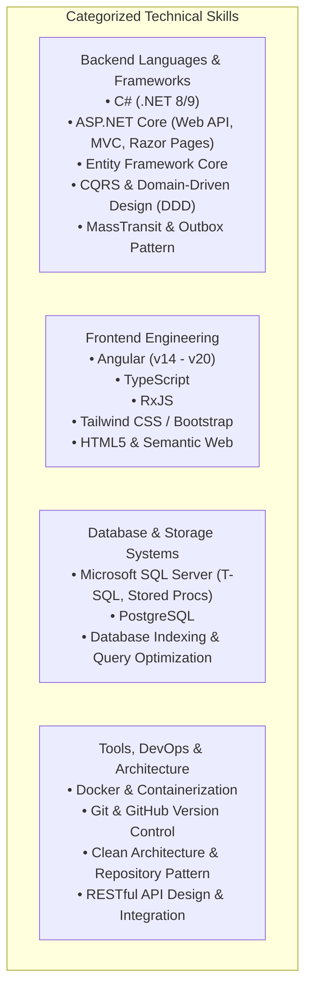

# Fuad Hasan Portfolio - Content Inventory & Verification Matrix

**Document ID:** FH-DOC-P0-001  
**Phase:** P0 (Fact Confirmation & Content Inventory)  
**Last Updated:** 13 November 2026  
**Status:** Seeded from Authoritative Resume & Awaiting Owner Approvals  

---

## 1. Professional Identity & Publication Classification

| Field | Source Value (Resume) | Classification | Publication Decision / Action |
|---|---|---|---|
| **Full Name** | Fuad Hasan | Public | Approved for public display. |
| **Professional Title**| Software Engineer (Full Stack) | Public | Formatted as `Full Stack Software Engineer` (FR-001). |
| **Location** | Dhaka, Bangladesh | Public | City and Country only. |
| **Residential Address**| [Present in private resume] | **PRIVATE** | **NEVER COMMIT OR PUBLISH** (SEC-06, NFR-006). |
| **Personal Phone** | [Present in private resume] | **PRIVATE** | **NEVER COMMIT OR PUBLISH** (SEC-06, NFR-006). |
| **Public Contact Email**| [Present in private resume] | **PENDING** | **Requires explicit owner confirmation** of the exact address before publication in `mailto:` links or metadata. |
| **Downloadable Resume** | [Private PDF provided] | **PENDING** | **Requires owner-approved sanitized PDF** without phone number or residential address before copying to `public/resume/`. |
| **Hero Photo / Avatar** | Not provided in repository | **PENDING** | Provide a professional headshot or approve typographic/abstract visual hero (per `wireframe_home.png`). |

### Draft Hero Copy (P0 Baseline)
- **Eyebrow:** `FULL STACK SOFTWARE ENGINEER`
- **Headline:** `Fuad Hasan`
- **Sub-headline:** `Building reliable systems and thoughtful web experiences.`
- **Specialization Line:** `C# / ASP.NET Core / Angular / PostgreSQL. Enterprise software, maintainable architecture, and practical technical writing.`
- **Primary CTA:** `Explore Projects` -> `/projects`
- **Secondary CTA:** `Download CV` -> `/resume/Fuad_Hasan_Resume.pdf` (enabled once sanitized PDF is provided)

---

## 2. Work History & Verified Contributions

*Rule: Retain factual responsibilities. Never invent numeric metrics, percentages, or unverified achievements.*

### 2.1 Efficient Software Solutions LTD
- **Role:** Software Engineer (Full Stack)
- **Tenure:** Mid-September 2025 – Present
- **Location:** Dhaka, Bangladesh
- **Core Technologies:** C#, ASP.NET Core, EF Core, SQL Server, Angular, MassTransit, RabbitMQ, PostgreSQL.
- **Verified Contributions (from Resume):**
  - Designed and developed scalable RESTful APIs using ASP.NET Core and Entity Framework Core.
  - Implemented asynchronous messaging and outbox patterns using MassTransit to improve reliability and transaction consistency across services.
  - Optimized complex SQL Server queries and EF Core database operations, reducing unnecessary database round-trips and improving response times.
  - Collaborated on responsive Angular frontend interfaces, integrating with backend services using reactive programming patterns (RxJS).
  - Maintained clean code practices, repository patterns, and structured error handling.
- **Unverified / Excluded Copy:** Any specific percentage improvements in latency, revenue numbers, or unverified client names.

### 2.2 Pakiza Software LTD
- **Role:** Jr. Software Developer
- **Tenure:** October 2024 – September 2025 (1 year)
- **Location:** Dhaka, Bangladesh
- **Core Technologies:** C#, ASP.NET MVC, SQL Server, jQuery, AJAX, HTML5, CSS3, Bootstrap.
- **Verified Contributions (from Resume):**
  - Developed and maintained core backend business logic for enterprise ERP systems serving textile and garment manufacturing workflows.
  - Built and enhanced features across Merchandising, Accounts, and Inventory modules.
  - Wrote and optimized complex SQL stored procedures, views, and functions to support large-scale enterprise reporting.
  - Diagnosed and resolved production bugs, improving data integrity and system stability.
- **Unverified / Excluded Copy:** Any unverified claims regarding financial transaction volumes or commercial impact metrics.

---

## 3. Flagship Projects & Case Study Inventory

| Project | Summary & Technologies | Evidence / Repositories | Missing Case Study Assets |
|---|---|---|---|
| **EduSubmit** | Assignment and submission management platform with role-based access (Admin, Teacher, Student). **Stack:** ASP.NET Core 9, Angular 20, EF Core, PostgreSQL, CQRS, DDD, JWT. | **API Repo:** `github.com/fuadhasan01/EduSubmitAPI` **Demo:** `edusubmit-web-gamma.vercel.app/login` | - Architecture diagram - Real application screenshots - Owner-written problem breakdown & trade-offs |
| **LibraryMS** | Multi-branch library management system handling lending, reservations, fine calculation, and RBAC. **Stack:** ASP.NET Core 9, Angular 14, PostgreSQL, Docker. | **Backend Repo:** `github.com/fuadhasan01/LibraryManagementSystemAPI` **Frontend Repo:** `github.com/fuadhasan01/LibraryManagementSystemFrontend` | - Architecture diagram - Application UI screenshots - Specific architectural decisions narrative |
| **Mini Account Management System** | Financial accounting application supporting account hierarchies, journal entries, and balanced vouchers. **Stack:** ASP.NET Core 8 Razor Pages, SQL Server. | **Repo:** `github.com/fuadhasan01/MiniAccountApp` **Demo:** `mincountapp.somee.com/` | - Account workflow diagram - UI screenshots - Case study narrative |

---

## 4. Skills & Technical Categorization

*Rule: Present clean categories; no arbitrary percentage meters or progress bars (FR-005, NFR-008).*

---

## 5. Education, Honors & Certifications

- **Degree:** Bachelor of Science in Computer Science and Engineering (BSc in CSE)
  - **Institution:** United International University (UIU), Dhaka, Bangladesh
  - **Graduation Period:** 2020 – 2024
  - **CGPA:** 3.6 / 4.0
  - **Major:** Software Engineering
- **Academic Honors & Achievements:**
  - UIU Project Show Champion for **ArtPatio** (digital art gallery web platform).
  - UIU Merit Scholarship awarded across 7 academic trimesters.
  - 500+ Algorithmic challenges solved across competitive programming platforms.
- **Training & Coursework:**
  - C# Fundamentals and Object-Oriented Programming.
  - ASP.NET Core Web API Development.
  - Modern Angular Enterprise Architecture.
  - *Note:* Formal certification badges or credential verification links must be confirmed by the owner before presenting as accredited certificates.

---

## 6. Technical Blog Articles (Launch Backlog)

Per SRS Section 3.5, 2–3 genuine technical articles are required for launch. The following initial drafts/topics are proposed based on verified professional expertise:

1. **Understanding the Outbox Pattern in .NET Applications**
   - *Category:* Distributed Systems / ASP.NET Core
   - *Focus:* Solving dual-write problems between relational databases and message brokers (MassTransit/RabbitMQ).
2. **Implementing CQRS in ASP.NET Core APIs Without Over-Engineering**
   - *Category:* Architecture / ASP.NET Core
   - *Focus:* Separating read models from write models using MediatR or lightweight handler patterns.
3. **Optimizing Entity Framework Core Queries in Production**
   - *Category:* Databases / .NET
   - *Focus:* Avoiding N+1 queries, effective use of projections (`Select`), index alignment, and query execution plans.

