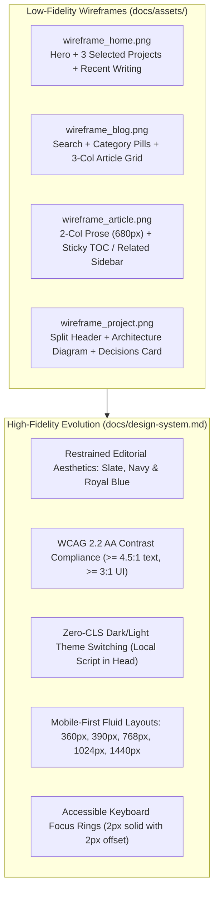
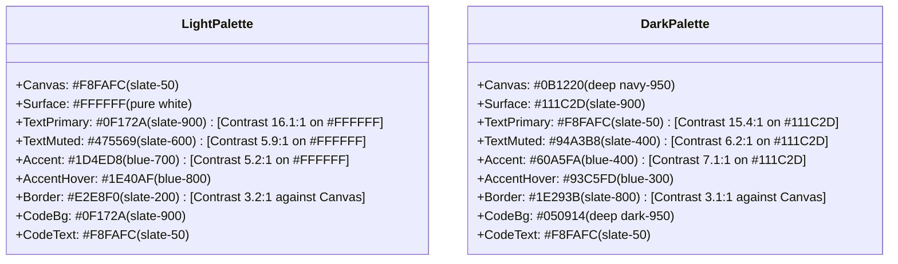
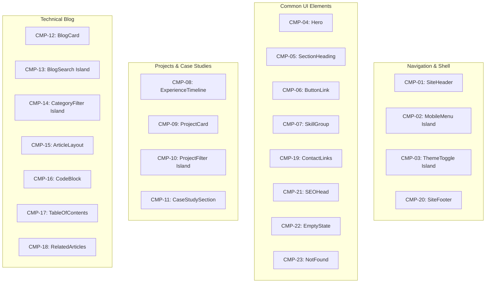

# Fuad Hasan Portfolio - Design System & Responsive UI Architecture

**Document ID:** FH-DOC-P1-001  
**Phase:** P1 (Architecture & System Design)  
**Last Updated:** 13 November 2026  
**Status:** High-Fidelity Specifications Awaiting Owner Sign-Off  
**SRS Reference:** Section 5, Section 6, Section 10, Section 15 (P1)  

---

## 1. Low-Fidelity Wireframe Review & High-Fidelity Evolution

The four low-fidelity wireframes in `docs/assets/` define content positioning and navigational flows. The high-fidelity design translates these wireframes into an editorial engineering interface:



### 1.1 Wireframe-to-UI Translation Matrix

| Low-Fi Wireframe | Key Layout Elements | High-Fi Desktop Specification ($\ge 1024$px) | High-Fi Mobile Specification ($360$–$390$px) |
|---|---|---|---|
| **`wireframe_home.png`** | Header, Eyebrow, H1, Subhead, Tech stack line, Primary CTA ("Explore Projects"), Secondary CTA ("Download CV"), Hero visual placeholder, Selected Projects (3 cards), Recent Writing teaser. | 2-column hero: Left 65% text & CTAs, Right 35% portrait or abstract SVG code visual; 3-column project grid; experience highlight bar; 3-column blog card grid. | Single-column stack. Brand and hamburger trigger in sticky header; hero image centered; CTAs stacked at full width ($\ge 44$px touch targets); project cards stacked vertically. |
| **`wireframe_blog.png`** | Category Eyebrow, H1 title, Subhead, Keyword Search Bar, Category Pills ("All", "ASP.NET Core", "Architecture", "Angular", "Database"), Results counter ("6 results"), 3-column article cards. | Search input with integrated SVG icon; horizontal flex pill list; live count indicator; 3-column responsive card grid with image, badge, title, excerpt, and read time. | Full-width search bar with clear button; horizontally scrollable category pill container with touch snap; 1-column card list; clear empty state on zero matches. |
| **`wireframe_article.png`**| Breadcrumb ("Blog / Category"), H1, Subhead, Metadata bar (Date, Read time, Tags), 2-column body: Left Prose + pseudo-code snippet, Right sticky sidebar ("On This Page" TOC, "Further Reading" cards). | 12-column grid: 8 columns (680–760px) prose with typography styling, copyable code blocks; 4 columns sticky sidebar tracking active headings via IntersectionObserver. | Single-column layout. Metadata bar wraps cleanly; TOC converted into top expandable disclosure (`<details>`); code blocks scroll horizontally; related articles at bottom. |
| **`wireframe_project.png`**| Eyebrow ("PROJECT CASE STUDY"), H1, Subhead, Technology pills, Action CTAs ("Repository", "Live demo"), Screenshot container, Problem statement, 2-column Architecture section (Diagram + Engineering decisions card). | Split header: 60% overview & buttons, 40% hero screenshot; Problem section in readable prose; Architecture section with interactive diagram container and structured key decisions callout card. | Stacked header; large touch-friendly repository and demo buttons; responsive diagram container with pinch-to-zoom/lightbox support; single-column decision highlights. |

---

## 2. High-Fidelity UI Layout & Visual Wireframe Blueprints

### 2.1 Desktop Homepage Layout ($\ge 1024$px, Max Width: 1200px)

```text
+---------------------------------------------------------------------------------------------------+
| [Brand: FUAD HASAN]                    Home   About   Experience   Projects   Blog   Contact  [Theme] |
+---------------------------------------------------------------------------------------------------+
|                                                                                                   |
|  FULL STACK SOFTWARE ENGINEER                                       +---------------------------+ |
|  Fuad Hasan                                                         | [Hero Visual Container]   | |
|  Building reliable systems and thoughtful web experiences.          | Professional Headshot     | |
|                                                                     | OR Abstract Technical     | |
|  C# / ASP.NET Core / Angular / PostgreSQL                           | SVG Code Emblem           | |
|  Enterprise software, maintainable architecture,                    |                           | |
|  and practical technical writing.                                   | (320px x 360px, rounded)  | |
|                                                                     +---------------------------+ |
|  [ Explore Projects (Blue CTA) ]    [ Download CV (Outline) ]                                     |
|                                                                                                   |
+---------------------------------------------------------------------------------------------------+
|  Selected Projects                                                            View all projects > |
|  +---------------------------+  +---------------------------+  +---------------------------+      |
|  | [EduSubmit Screen]        |  | [LibraryMS Screen]        |  | [Mini Account Screen]     |      |
|  | EduSubmit                 |  | LibraryMS                 |  | Mini Account System       |      |
|  | Full-stack assignment     |  | Multi-branch operations   |  | Financial accounting      |      |
|  | platform with CQRS & DDD. |  | with lending & RBAC.      |  | records & vouchers.       |      |
|  | [ASP.NET Core] [Angular]  |  | [ASP.NET Core] [Docker]   |  | [ASP.NET Core] [SQL Serv] |      |
|  | Case Study >              |  | Case Study >              |  | Case Study >              |      |
|  +---------------------------+  +---------------------------+  +---------------------------+      |
+---------------------------------------------------------------------------------------------------+
|  Recent Writing                                                                View all posts >   |
|  +---------------------------+  +---------------------------+  +---------------------------+      |
|  | [Outbox Pattern Cover]    |  | [CQRS Patterns Cover]     |  | [EF Core Queries Cover]   |      |
|  | Architecture              |  | ASP.NET Core              |  | Database                  |      |
|  | Understanding Outbox      |  | Getting Started with CQRS |  | Practical EF Core Queries |      |
|  | Pattern in .NET           |  | in Clean Architecture     |  | for High Performance      |      |
|  | 13 Nov 2026 • 7 min read  |  | 10 Nov 2026 • 6 min read  |  | 05 Nov 2026 • 8 min read  |      |
|  +---------------------------+  +---------------------------+  +---------------------------+      |
+---------------------------------------------------------------------------------------------------+
| (c) 2026 Fuad Hasan • GitHub • LinkedIn • LeetCode • RSS Feed                        Privacy Note |
+---------------------------------------------------------------------------------------------------+
```

---

### 2.2 Mobile Homepage Layout ($360$px – $390$px)

```text
+-----------------------------------------------+
| [FUAD HASAN]                     [Theme] [ = ]|
+-----------------------------------------------+
|                                               |
| FULL STACK SOFTWARE ENGINEER                  |
| Fuad Hasan                                    |
| Building reliable systems and                 |
| thoughtful web experiences.                   |
|                                               |
| +-------------------------------------------+ |
| | [Centered Hero Visual Container]          | |
| | (240px x 240px, rounded-2xl)              | |
| +-------------------------------------------+ |
|                                               |
| C# / ASP.NET Core / Angular / PostgreSQL      |
| Enterprise software, clean architecture.      |
|                                               |
| [ Explore Projects           ] (48px height)  |
| [ Download CV                ] (48px height)  |
|                                               |
+-----------------------------------------------+
| Selected Projects         View all projects > |
|                                               |
| +-------------------------------------------+ |
| | [EduSubmit Screenshot]                    | |
| | EduSubmit                                 | |
| | Full-stack assignment platform.           | |
| | [ASP.NET Core] [Angular] [CQRS]           | |
| | Case Study >                              | |
| +-------------------------------------------+ |
|                                               |
| +-------------------------------------------+ |
| | [LibraryMS Screenshot]                    | |
| | LibraryMS                                 | |
| | Multi-branch library management system.   | |
| | [ASP.NET Core] [PostgreSQL] [Docker]      | |
| | Case Study >                              | |
| +-------------------------------------------+ |
+-----------------------------------------------+
| Recent Writing               View all posts > |
|                                               |
| +-------------------------------------------+ |
| | [Cover Image]                             | |
| | Architecture • 7 min read                 | |
| | Understanding Outbox Pattern in .NET      | |
| +-------------------------------------------+ |
+-----------------------------------------------+
| (c) 2026 Fuad Hasan                           |
| GitHub • LinkedIn • LeetCode • RSS            |
+-----------------------------------------------+
```

---

### 2.3 Desktop Blog Catalog Layout ($\ge 1024$px)

```text
+---------------------------------------------------------------------------------------------------+
| [Brand: FUAD HASAN]                    Home   About   Experience   Projects   Blog   Contact  [Theme] |
+---------------------------------------------------------------------------------------------------+
| TECHNICAL WRITING                                                                                 |
| Blog & Engineering Notes                                                                          |
| Practical guides, architectural patterns, and production lessons from real-world systems.        |
|                                                                                                   |
| +-----------------------------------------------------------------------------------------------+ |
| | [Search Icon] Search articles by keyword, technology, or topic...                             | |
| +-----------------------------------------------------------------------------------------------+ |
|                                                                                                   |
| [All (Active)]  [ASP.NET Core]  [Architecture]  [Distributed Systems]  [Databases]  [Angular]     |
|                                                                                                   |
| Showing 3 articles                                                                                |
| +---------------------------+  +---------------------------+  +---------------------------+      |
| | [Article Cover Image]     |  | [Article Cover Image]     |  | [Article Cover Image]     |      |
| | [Distributed Systems]     |  | [Architecture]            |  | [Databases]               |      |
| | Understanding the Outbox  |  | Practical CQRS in .NET:   |  | EF Core Query Tuning:     |      |
| | Pattern in .NET Apps      |  | Clear Separation of Roles |  | Projections and Indexes   |      |
| | How to guarantee database |  | Clean handler patterns    |  | How to diagnose slow      |      |
| | changes and event pub.    |  | without unnecessary bloat.|  | queries and reduce round- |      |
| | 13 Nov 2026 • 7 min read  |  | 08 Nov 2026 • 6 min read  |  | trips in production.      |      |
| |                           |  |                           |  | 01 Nov 2026 • 8 min read  |      |
| +---------------------------+  +---------------------------+  +---------------------------+      |
+---------------------------------------------------------------------------------------------------+
```

---

## 3. Design System Tokens & WCAG 2.2 AA Contrast Compliance

### 3.1 Color Palette & Contrast Ratios

Colors are organized into CSS custom properties under `:root` and `.dark`, using Tailwind utility conventions. Every foreground/background pairing has been calculated to satisfy **WCAG 2.2 Level AA ($\ge 4.5:1$)** for body text and **Level AA ($\ge 3:1$)** for large text, badges, and interactive controls:



| Semantic Token | Light Mode Value | Dark Mode Value | Measured Contrast Ratio | WCAG 2.2 AA Status |
|---|---|---|---|---|
| `bg-canvas` | `#F8FAFC` | `#0B1220` | Canvas base | Pass |
| `bg-surface` | `#FFFFFF` | `#111C2D` | Surface cards | Pass |
| `text-primary` | `#0F172A` | `#F8FAFC` | Light: **16.1:1** \| Dark: **15.4:1** | **Pass (Exceeds AAA 7:1)** |
| `text-muted` | `#475569` | `#94A3B8` | Light: **5.9:1** \| Dark: **6.2:1** | **Pass (Exceeds AA 4.5:1)** |
| `text-accent` / `link` | `#1D4ED8` | `#60A5FA` | Light: **5.2:1** \| Dark: **7.1:1** | **Pass (Exceeds AA 4.5:1)** |
| `border-subtle` | `#E2E8F0` | `#1E293B` | UI boundary separator | **Pass ($\ge 3:1$ for UI)** |
| `badge-bg` | `#EFF6FF` | `#1E293B` | Category tag container | Pass |
| `badge-text` | `#1D4ED8` | `#93C5FD` | Light: **5.2:1** \| Dark: **9.8:1** | **Pass** |
| `focus-ring` | `#2563EB` | `#60A5FA` | 2px solid with 2px offset | **Pass** |

---

### 3.2 Typography Tokens

- **UI & Prose Font Stack:** `Inter, -apple-system, BlinkMacSystemFont, "Segoe UI", Roboto, sans-serif`
- **Code & Snippets Font Stack:** `JetBrains Mono, ui-monospace, SFMono-Regular, Menlo, Monaco, Consolas, monospace`

| Scale Role | Font Size (Desktop) | Font Size (Mobile) | Line Height | Weight | Tracking / Letter Spacing |
|---|---|---|---|---|---|
| **Display H1** | `44px` (`2.75rem`) | `32px` (`2.0rem`) | `1.15` | `700` (Bold) | `-0.025em` (Tight) |
| **Section H2** | `30px` (`1.875rem`) | `24px` (`1.5rem`) | `1.25` | `600` (Semibold) | `-0.02em` |
| **Card H3** | `20px` (`1.25rem`) | `18px` (`1.125rem`) | `1.35` | `600` (Semibold) | `-0.01em` |
| **Eyebrow / Label** | `13px` (`0.8125rem`)| `12px` (`0.75rem`) | `1.4` | `600` (Semibold) | `+0.05em` (Uppercase) |
| **Body (Prose)** | `17px` (`1.0625rem`)| `16px` (`1.0rem`) | `1.7` | `400` (Regular) | `normal` |
| **Body Small** | `14px` (`0.875rem`) | `14px` (`0.875rem`) | `1.5` | `400` (Regular) | `normal` |
| **Code Snippet** | `14px` (`0.875rem`) | `13px` (`0.8125rem`)| `1.6` | `400` (Regular) | `normal` |

---

### 3.3 Spacing, Radii & Elevation Tokens

- **Spacing Scale:** `4px` (`p-1`), `8px` (`p-2`), `12px` (`p-3`), `16px` (`p-4`), `24px` (`p-6`), `32px` (`p-8`), `48px` (`p-12`), `64px` (`p-16`), `96px` (`p-24`).
- **Container Max-Widths:** Site shell: `1200px` (`max-w-6xl`); Prose reading: `720px` (`max-w-prose`).
- **Border Radii:** Badges/Pills: `9999px` (`rounded-full`); Buttons/Inputs: `8px` (`rounded-lg`); Cards/Containers: `16px` (`rounded-2xl`).
- **Shadows (Restrained):**
  - Card default: `0 1px 3px 0 rgb(0 0 0 / 0.05), 0 1px 2px -1px rgb(0 0 0 / 0.05)`
  - Card hover: `0 10px 15px -3px rgb(0 0 0 / 0.08), 0 4px 6px -4px rgb(0 0 0 / 0.05)`
- **Focus Indicators:** Focusable interactive elements will use:
  ```css
  focus-visible:outline-none focus-visible:ring-2 focus-visible:ring-blue-600 focus-visible:ring-offset-2 dark:focus-visible:ring-blue-400 dark:focus-visible:ring-offset-slate-900
  ```

---

## 4. Reusable Component Inventory (`CMP-01` to `CMP-23`)



### Component Specification Directory

| ID | Component | Mode | Props Interface | Accessibility Behavior |
|---|---|---|---|---|
| `CMP-01` | `SiteHeader.astro` | Static | `currentPath: string` | Sticky header with `<header role="banner">`, semantic `<nav aria-label="Main Navigation">`, active link indicator with `aria-current="page"`. |
| `CMP-02` | `MobileMenu.astro` | Island | `navLinks: Array<{ label, href }>` | Hamburger button with `aria-expanded` and `aria-controls`. Focus trapped inside modal drawer when open; closes on `Escape` key. |
| `CMP-03` | `ThemeToggle.astro` | Island | *(none)* | `<button aria-label="Switch theme">`. Runs inline script in `<head>` to prevent flash of wrong theme; toggles `.dark` class and syncs with `localStorage`. |
| `CMP-04` | `Hero.astro` | Static | `title, eyebrow, subhead, primaryCta, secondaryCta` | `<section role="region" aria-label="Introduction">` with single `<h1>`. Fully semantic anchor actions with large touch targets. |
| `CMP-05` | `SectionHeading.astro`| Static | `eyebrow?: string, title: string, description?: string` | Semantic `<h2>` with uppercase eyebrow label and readable subtitle. |
| `CMP-06` | `ButtonLink.astro` | Static | `href, variant: 'primary' \| 'secondary' \| 'outline', external?: boolean` | `<a>` tag with focus ring styling. If `external=true`, appends `target="_blank"` and `rel="noopener noreferrer"`. |
| `CMP-07` | `SkillGroup.astro` | Static | `category: string, skills: string[]` | Semantic `<ul>` list with accessible badges. No arbitrary percentage bars or subjective meters. |
| `CMP-08` | `ExperienceTimeline.astro`| Static | `items: ExperienceItem[]` | `<ol>` chronological list; semantic `<time>` tags for dates; role titles in `<h3>`. |
| `CMP-09` | `ProjectCard.astro` | Static | `project: CollectionEntry<'projects'>` | `<article>` card with picture/fallback, tech badges, and case study CTA link. Entire card is keyboard navigable. |
| `CMP-10` | `ProjectFilter.astro`| Island | `categories: string[]` | Filter pill buttons with `aria-pressed="true|false"`. Dynamically updates visible card list without page reload. |
| `CMP-11` | `CaseStudySection.astro`| Static | `title: string, id: string` | Structured section with clear `<h2>` anchor, formatted prose, and visual callout blocks. |
| `CMP-12` | `BlogCard.astro` | Static | `post: CollectionEntry<'blog'>` | Semantic `<article>` card with publication date in `<time dateTime="...">`, category badge, and estimated reading time. |
| `CMP-13` | `BlogSearch.astro` | Island | `posts: SearchIndexItem[]` | `<search role="search">` with `<input type="search" aria-label="Search articles">`. Live results count announced via `aria-live="polite"`. |
| `CMP-14` | `CategoryFilter.astro`| Island | `categories: string[], activeCategory?: string` | Interactive filter pill bar that combines with keyword query; includes reset button. |
| `CMP-15` | `ArticleLayout.astro`| Static | `post: CollectionEntry<'blog'>, headings: MarkdownHeading[]` | Semantic `<article>` element, breadcrumb navigation, reading progress indicator, and responsive 2-column grid. |
| `CMP-16` | `CodeBlock.astro` | Static+JS| `code: string, language: string` | `<pre>` with copy button. Copy action provides visual/spoken feedback ("Copied!") and handles keyboard triggers. |
| `CMP-17` | `TableOfContents.astro`| Static+JS| `headings: MarkdownHeading[]` | `<nav aria-label="Table of contents">`. Sticky sidebar on desktop; collapsible `<details>` accordion on mobile. Active heading highlighted on scroll. |
| `CMP-18` | `RelatedArticles.astro`| Static | `currentSlug: string, tags: string[]` | Query computes 2–3 published posts sharing tags or category; excludes current slug. |
| `CMP-19` | `ContactLinks.astro` | Static | `email: string, socialLinks: SocialLink[]` | Safe `mailto:` link with "Copy Email" clipboard button; external profiles open safely with `rel="noopener noreferrer"`. |
| `CMP-20` | `SiteFooter.astro` | Static | *(none)* | `<footer role="contentinfo">` with secondary nav, RSS link, copyright notice, and privacy statement. |
| `CMP-21` | `SEOHead.astro` | Static | `title, description, image?, articleData?` | Canonical `<link>`, OpenGraph tags, Twitter card tags, and JSON-LD structured data (`Person`, `WebSite`, `BlogPosting`). |
| `CMP-22` | `EmptyState.astro` | Static | `title: string, message: string, onReset?: string` | Informative zero-results container with an accessible "Reset filters" button. |
| `CMP-23` | `NotFound.astro` | Static | *(none)* | Clean 404 recovery page with search link and direct routes back to Home, Projects, and Blog. |

---

## 5. Content Schemas & Data Model Specifications

Content schemas are validated at build time using Astro 5 Content Collections and Zod. Drafts (`published: false`) are strictly omitted from public routes, search indexes, sitemaps, and RSS feeds.

```typescript
// src/content.config.ts
import { defineCollection, z } from 'astro:content';
import { glob } from 'astro/loaders';

export const blog = defineCollection({
  loader: glob({ pattern: '**/*.md', base: './src/content/blog' }),
  schema: z.object({
    title: z.string().min(5),
    excerpt: z.string().min(10),
    published: z.boolean().default(false),
    pubDate: z.coerce.date(),
    updatedDate: z.coerce.date().optional(),
    category: z.enum([
      'ASP.NET Core',
      'Architecture',
      'Distributed Systems',
      'Databases',
      'Angular',
      'Engineering Notes'
    ]),
    tags: z.array(z.string()).min(1),
    cover: z.string().startsWith('/images/blog/'),
    coverAlt: z.string().min(5),
    seoTitle: z.string().max(70).optional(),
    seoDescription: z.string().max(160).optional()
  }).refine((data) => {
    if (data.updatedDate && data.pubDate) {
      return data.updatedDate >= data.pubDate;
    }
    return true;
  }, {
    message: 'updatedDate must be >= pubDate',
    path: ['updatedDate']
  })
});

export const projects = defineCollection({
  loader: glob({ pattern: '**/*.md', base: './src/content/projects' }),
  schema: z.object({
    title: z.string().min(3),
    summary: z.string().min(10),
    featured: z.boolean().default(false),
    status: z.enum(['completed', 'in-progress', 'archived']).default('completed'),
    technologies: z.array(z.string()).min(1),
    cover: z.string().startsWith('/images/projects/'),
    coverAlt: z.string().min(5),
    repositoryUrl: z.string().url().optional(),
    demoUrl: z.string().url().optional(),
    role: z.string().default('Lead Engineer / Full Stack Developer'),
    timeline: z.string().optional()
  })
});
```

---

## 6. Accepted Architecture Decision Records (ADRs) Summary

All 7 fundamental architecture decision records have been formalized in `docs/adr/`:

| ADR ID | Title | Summary |
|---|---|---|
| [`ADR-001`](file:///c:/Fuad/WorkStation/fuad-portfolio/docs/adr/ADR-001-astro-static-generation.md) | Astro Static Generation over SSR / Full-Client SPAs | Guarantees top performance, $0/month compute cost, and zero server maintenance. |
| [`ADR-002`](file:///c:/Fuad/WorkStation/fuad-portfolio/docs/adr/ADR-002-typed-content-collections.md) | Markdown & Typed Content Collections instead of Database | Version-controlled content in Git with compile-time Zod schema validation. |
| [`ADR-003`](file:///c:/Fuad/WorkStation/fuad-portfolio/docs/adr/ADR-003-pages-cms-integration.md) | Pages CMS backed by GitHub OAuth instead of Custom Admin | Safe editorial web UI without exposing a public `/admin` attack surface or session DB. |
| [`ADR-004`](file:///c:/Fuad/WorkStation/fuad-portfolio/docs/adr/ADR-004-cloudflare-pages-hosting.md) | Cloudflare Pages for Static Hosting | Global edge CDN, unlimited bandwidth on free tier, and automated preview PRs. |
| [`ADR-005`](file:///c:/Fuad/WorkStation/fuad-portfolio/docs/adr/ADR-005-mailto-contact-baseline.md) | Obfuscated Email Link Baseline instead of Backend Form | Zero spam API dependencies; direct mail client opening with one-click copy button. |
| [`ADR-006`](file:///c:/Fuad/WorkStation/fuad-portfolio/docs/adr/ADR-006-static-case-studies-no-ai-chat.md) | Static Case Studies instead of AI Chatbot in v1 | Eliminates hallucinations, token API costs, and recruiter navigation friction. |
| [`ADR-007`](file:///c:/Fuad/WorkStation/fuad-portfolio/docs/adr/ADR-007-configurable-domain-origin.md) | Externalized Domain Origin Configuration | Configurable base URL prevents canonical penalties and hardcoded `.pages.dev` URLs. |

---

## 7. Responsive Inspection & Verification Matrix

During UI implementation (P2/P3), all screens will be verified across five standard responsive breakpoints:

```text
+-------------------+-------------------+-------------------+-------------------+-------------------+
| 360px             | 390px             | 768px             | 1024px            | 1440px            |
| Small Android     | Standard iPhone   | Tablet (Portrait) | Laptop / Desktop  | Wide Display      |
| 1-col stack       | 1-col stack       | 2-col grids       | Full 3-col grid   | Centered max-1200 |
| Touch CTAs >=44px | Touch CTAs >=44px | Sidebar collap.   | Sticky TOC        | Comfortable read  |
+-------------------+-------------------+-------------------+-------------------+-------------------+
```

- **Horizontal Overflow Check:** `document.documentElement.scrollWidth === window.innerWidth` across all breakpoints.
- **Theme Check:** Flawless contrast and readability in both Light and Dark themes.
- **Keyboard Navigation:** Full Tab/Shift+Tab focus traversal with visible 2px outline; modal dismissal via `Escape`.
- **Reduced Motion:** When `prefers-reduced-motion: reduce` is active, animations and transitions are disabled or set to $\le 1$ms.

