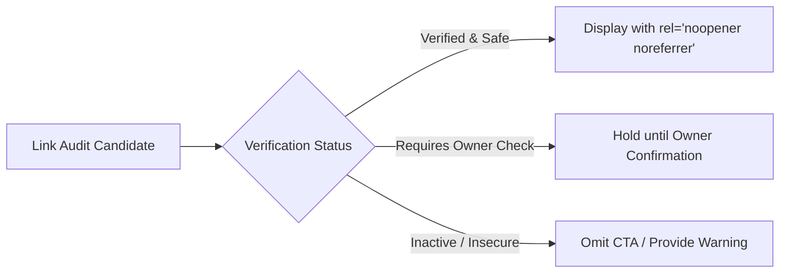

# Fuad Hasan Portfolio - Public Links Audit & Verification Log

**Document ID:** FH-DOC-P0-002  
**Audit Date:** 13 November 2026  
**Auditor:** Antigravity AI Agent  
**SRS Reference:** Section 3.1, Section 3.3, FR-008, SEC-04  

---

## 1. Executive Audit Summary

Every external link planned for public display in the portfolio must be verified for active status, protocol security (HTTPS), and accessibility. Per requirement **FR-008**, if a destination is broken, unverified, or inactive, the user interface must cleanly omit the action button rather than displaying a broken or confusing link.

---

## 2. Professional Profiles & Social Destinations

| Target Platform | URL in Resume / Candidate | Web Verification Status | Protocol Security | Publication Recommendation |
|---|---|---|---|---|
| **GitHub** | `https://github.com/fuadhasan01` | **Verified Active** (corroborated via web search) | HTTPS (Secure) | **Approved for display** in header, contact page, and footer. |
| **LinkedIn** | `https://linkedin.com/in/fuadhasan01` | Listed on resume | HTTPS (Secure) | **Pending Owner Confirmation** (verify custom vanity slug is active). |
| **LeetCode** | `https://leetcode.com/u/fuadhasan01/` | **Verified Active** (profile indexed at `leetcode.com/fuadhasan01/`) | HTTPS (Secure) | **Approved for display** in footer and about page. |
| **HackerRank** | `https://www.hackerrank.com/profile/fuadhasan01` | **Unverified / Not Indexed** (search did not find active public profile) | HTTPS (Secure) | **Hold / Owner Check Required.** If inactive, omit link to prevent broken CTA. |
| **Medium (Discovered)** | `https://medium.com/@fuadhasan01` | Active technical profile discovered during web search | HTTPS (Secure) | **Proposed Option.** Ask owner if Medium profile should be featured alongside blog. |

---

## 3. Project Repositories

| Project Name | Code Repository URL | Intended Visibility | Recommendation |
|---|---|---|---|
| **EduSubmit API** | `https://github.com/fuadhasan01/EduSubmitAPI` | Public | Display as primary repository link on EduSubmit case study. |
| **LibraryMS Backend** | `https://github.com/fuadhasan01/LibraryManagementSystemAPI` | Public | Display as Backend repository link on LibraryMS case study. |
| **LibraryMS Frontend**| `https://github.com/fuadhasan01/LibraryManagementSystemFrontend` | Public | Display as Frontend repository link on LibraryMS case study. |
| **Mini Account System**| `https://github.com/fuadhasan01/MiniAccountApp` | Public | Display as primary repository link on Mini Account case study. |

*Action for Owner:* Confirm all 4 repositories are set to **Public** visibility on GitHub so recruiters and engineering managers can inspect source code without 404 errors.

---

## 4. Project Live Demonstrations

| Project Name | Demo URL | Verification Findings | Risk & Protocol Notes | Launch Action |
|---|---|---|---|---|
| **EduSubmit** | `https://edusubmit-web-gamma.vercel.app/login` | Verified live Vercel deployment. | Uses HTTPS. Note: The `-gamma` slug indicates a preview/staging branch deployment. | **Approved for display**, provided owner verifies the backend API connected to it is operational. |
| **Mini Account System** | `http://mincountapp.somee.com/` | Identified as Somee.com free Windows ASP.NET hosting. | **Insecure Protocol (HTTP)**. Free tier hosting on Somee is subject to cold sleeps, quotas, and inactivity shutdowns. | **Owner Check Required.** Test if server is currently running. If sleep/certificate issues exist, omit the "Live Demo" button and emphasize the repository link. |
| **LibraryMS** | *(None listed in resume)* | No public demo URL provided in resume. | N/A | **Omit demo button** cleanly per FR-008; feature GitHub repositories and architecture diagrams. |

---

## 5. Domain & Origin Candidates

| Option | Candidate Domain | Cost | Requirements & Integration Steps | Status |
|---|---|---|---|---|
| **Option A (Free)** | `fuadhasan.is-a.dev` | $0 | Requires pull request to `is-a-dev/register` repository and Cloudflare Pages DNS binding. | Proposed; awaiting owner selection. |
| **Option B (Paid)** | `fuadhasan.dev` (or `.me` / `.com`) | ~$12–$20/yr | Direct registration via registrar (Cloudflare Registrar, Porkbun, etc.) and custom domain configuration in Cloudflare Pages. | Proposed; awaiting owner selection. |
| **Staging Fallback** | `fuad-portfolio.pages.dev` | $0 | Automatic Cloudflare Pages technical origin for internal QA and smoke testing. | Built-in fallback; canonical tag will point to primary domain. |

---

## 6. Implementation Guardrails for External Links (SEC-04, FR-008)

1. **Security Attributes:** All external anchor tags (`<a>`) must include `target="_blank"` and `rel="noopener noreferrer"` to prevent tab-nabbing and credential leaks.
2. **Conditional Rendering:** Component `ButtonLink.astro` or `ProjectCard.astro` must inspect `demoUrl` and `repositoryUrl`. If undefined or empty, the button must not be rendered.
3. **No Dead Links:** Do not render dummy placeholders like `#` or `javascript:void(0)`.

